# realtime-asr 架构

本文是系统结构、模块边界、依赖关系和架构约束的权威依据。

本文描述已确认的目标架构，不表示设计已经实现。产品范围见 [PRD](PRD.md)，交付顺序见[项目规划](ROADMAP.md)。具体功能的输入、事件字段、错误和验收条件由 Spec 定义。

本文用于指导后续模块设计和功能设计。设计者应能据此判断能力放在哪个模块、数据由谁维护、模块如何交接工作，以及哪些规则不能被局部实现绕过。

## 阅读导航

| 需要了解的内容 | 对应章节 |
| --- | --- |
| 系统边界、主要组成及使用形态 | [系统概览](#系统概览) |
| 整体技术方案、模块选型与环境边界 | [技术栈](#技术栈) |
| 模块职责及跨模块交接 | [模块](#模块) |
| 模块可以依赖谁，以及禁止绕过的边界 | [依赖规则](#依赖规则) |
| 音频、结果、取消请求如何经过系统 | [数据流](#数据流) |
| 模型共享、会话隔离和执行资源归属 | [运行结构与资源归属](#运行结构与资源归属) |
| 准备、音频单元结束、关闭及失败的责任 | [生命周期与责任交接](#生命周期与责任交接) |
| 模型准备和安装依赖的访问边界 | [外部服务与包边界](#外部服务与包边界) |
| 新功能如何沿用架构，以及 Spec 应补充什么 | [架构约束与后续设计](#架构约束与后续设计) |

## 系统概览

### 系统边界

系统由 Python 核心库、命令行工具、识别服务、远程客户端和浏览器使用界面组成。核心库提供统一的音频处理、音频单元组织、模型调用和结果事件。

系统提供两种音频用法：使用麦克风；接收外部音频。麦克风采集器将采集结果送入核心库。接入程序将已有音频直接交给核心库，或通过识别服务提交。

Python SDK 是核心库的公开接口。命令行工具和识别服务通过公开接口使用核心能力，不各自实现一套识别流程。

外部调用程序、操作系统音频设备和模型运行库位于系统的接入边界之外。项目负责设备与模型的适配。正式能力、只验证项和当前不做项以 [PRD 的范围分类](PRD.md#当前范围)为准。

### 系统总体架构图

下图展示系统主要组成。实线箭头表示调用依赖，虚线箭头表示实现统一接口。返回数据的路径在“数据流”章节展示。

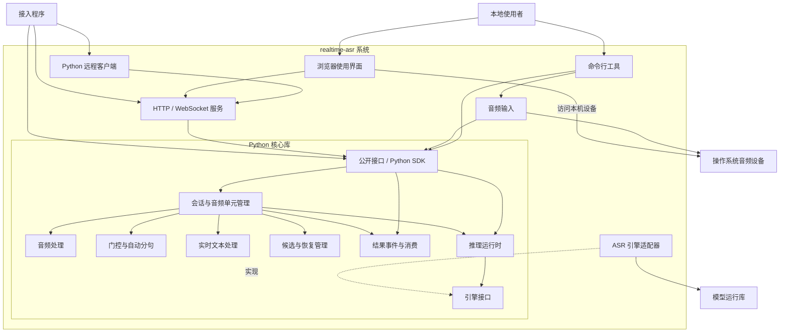

麦克风、文件和标准输入读取器向核心送入音频。浏览器和远程客户端访问自身设备，再把音频送入服务；服务端不访问客户端设备。

会话统一管理音频、任务归属和控制请求。门控与自动分句提供边界判断，实时文本处理维护文本稳定和合并状态，候选与恢复管理维护请求及候选代次。三者不能另建独立音频所有权。

推理运行时经引擎接口使用所选适配器，拥有模型、任务队列和执行资源。组装入口负责选择适配器并建立依赖；核心逻辑不直接调用模型运行库。

结果先经过会话有效性检查，再进入核心事件出口。CLI、服务和浏览器负责交付或展示，不能重新推导结果归属。

图中的模块是职责边界，不代表固定文件或线程数量。技术栈已确认后台工作线程、共享运行时和服务事件循环的分工。模型规格、实例数量及容量由基线与对应功能验证确定。

### 建设范围对架构的影响

| 范围类别 | 架构处理 |
| --- | --- |
| 正式建设 | 音频、会话、实时文本、候选、唤醒和服务能力有明确模块、状态与交接关系。后做的模块仍属于目标结构。 |
| Qwen、FunASR 只验证 | 用隔离的评估入口调用候选运行时。正式包、引擎注册、能力查询和发布依赖不纳入未批准适配器。 |
| 当前不做的引擎 | 不添加空实现、预加载器或后续必做适配任务。保留通用引擎契约即可。 |
| 实验标点模式 | 门控与分句只接入已确认的句末模式，不开放逗号、破折号、省略号或 all。 |
| 云端识别、聊天、TTS、翻译及桌面应用 | 不建立相应模型调用模块或产品流程。其他程序通过公开 ASR 接口消费结果。 |
| 旧双 WebSocket 兼容 | 不建立兼容协议层，远程客户端与服务使用本项目协议。 |

此表说明结构影响，不重复维护产品范围。增加或移除能力时，先更新 PRD，再核对模块、数据流和资源关系。

### 使用形态

| 使用形态 | 谁提供音频 | 谁管理运行时 | 结果如何到达使用者 |
| --- | --- | --- | --- |
| 命令行使用麦克风 | 项目的麦克风采集器。 | 命令行工具创建并关闭自身运行时。 | 命令行工具消费核心事件，输出文本或 JSON。 |
| 命令行识别文件或标准输入 | 项目的文件或标准输入读取器。 | 命令行工具创建并关闭自身运行时。 | 命令行工具输出识别结果。 |
| 浏览器使用 | 浏览器采集本机麦克风，通过 WebSocket 送音频。 | 服务管理共享运行时。 | 浏览器消费服务事件并展示结果、来源和时间线。 |
| 远程客户端 | 客户端读取设备或接收调用方音频。 | 服务管理共享运行时；客户端管理连接。 | 客户端转换服务事件，保留原始归属。 |
| Python SDK 接入 | 宿主程序提供音频。 | 宿主程序管理其创建或持有的运行时。 | 宿主程序通过公开接口读取结果事件。 |
| HTTP 完整音频识别 | 客户端提交完整音频。 | 服务管理共享运行时。 | 服务将核心终结结果转换为 HTTP 响应。 |
| WebSocket 持续识别 | 客户端持续发送音频。 | 服务管理共享运行时，各连接使用独立会话。 | 服务将会话事件发送给对应客户端。 |

SDK、HTTP 和 WebSocket 是接入方式，不是新的音频来源。

如果远程客户端使用麦克风，客户端负责采集并通过 WebSocket 发送音频。服务端接收客户端提供的音频，不访问客户端的麦克风设备。

完整音频识别可以不产生实时文本。它仍使用同一套音频规则、最终识别调度和引擎接口，不另建模型调用链路。

### 核心概念

| 概念 | 含义 |
| --- | --- |
| 运行时 | 管理模型、推理队列和执行资源的对象。一个运行时可以服务多个会话。 |
| 会话 | 一路音频输入及其配置、音频单元和结果的归属范围。 |
| 音频单元 | 一次识别工作覆盖的音频。自动模式为录音段，手动模式为整轮音频。 |
| 录音段 | 自动分句产生的连续语音片段，可在同一会话中产生多个。 |
| 整轮音频 | 调用方控制开始与结束的音频范围；短暂停顿或同轮继续不结束整轮。 |
| 推理任务 | 引擎对指定音频执行的一次工作。包含实时、极速实时、候选、提前最终和最终任务。 |
| 实时文本 | 音频单元尚未完成时的识别假设，后续结果可以替换。 |
| 稳定前缀 | 实时文本处理已提交的显示部分；最终识别仍可能产生不同文本。 |
| 候选文本 | 对音频快照的一次识别或尾部修复结果，带来源和覆盖范围。 |
| 同轮继续 | 保留整轮音频，建立新的候选边界与恢复代次，再继续接收音频。 |
| 最终文本 | 音频单元封口后的完成文本，说明实际采用的识别策略。 |
| 终结结果 | 最终成功、取消或失败的结果。具体事件定义由 Spec 维护。 |
| 会话代次 | 区分会话重置前后工作的标识；针对任务的取消另有失效范围。 |
| 音频版本 | 已接受标准音频的进度标识，用于判断快照是否覆盖当前音频。 |
| 候选／恢复代次 | 同一音频单元内区分新旧候选与恢复操作的标识，不等同于会话代次。 |
| 标准音频 | 核心处理链路使用的统一采样格式。 |

会话可以连续接收多句音频。音频单元结束不等于会话关闭。推理任务结束也不等于音频输入停止。

## 技术栈

### 整体技术方案

系统采用 Python 核心库，CLI、Python SDK 和识别服务复用核心能力。开发与本机验证使用 Windows x64、CPython 3.12。uv 管理解释器选择、项目虚拟环境和 Python 依赖。

核心运行时采用共享模型、有界任务队列和后台工作线程。引擎适配器封装模型运行库，会话维护自身音频与状态。网络服务采用 FastAPI 和 Uvicorn，浏览器采用 React、TypeScript 和 Vite。

下图展示技术如何组合。实线箭头表示运行时调用或数据交接，虚线箭头表示构建产物交付。前端构建和 Python 环境管理不进入每次识别请求。

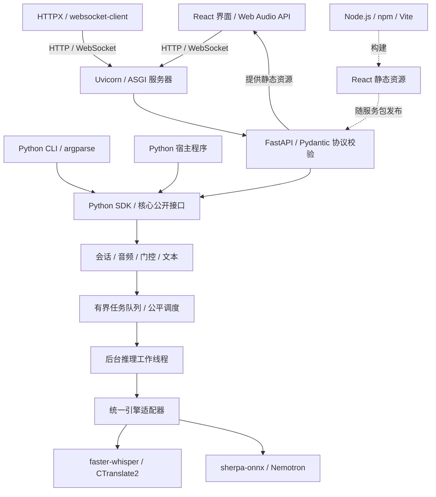

本节记录已确认的技术设计，不表示相应能力已实现或通过真实验收。固定基线参数由 [P0 Spec](specs/runtime-and-corpus-baseline.md)维护，实际环境和验证结果见 [STATUS](STATUS.md)。安装命令、任务和执行顺序由使用说明及实施 Plan 维护。

### Python 环境、依赖与发布

| 部分 | 技术选择与用途 | 选择理由与约束 |
| --- | --- | --- |
| Python | CPython 3.12，64 位；当前开发基线使用已有的 uv Python 3.12.14。 | 复用已安装解释器，统一开发与验证版本。其他版本不据此自动进入支持矩阵。 |
| 环境管理 | uv，项目虚拟环境位于根目录 `.venv`。 | 环境、依赖解析、同步和运行使用同一工具，隔离其他项目的 Python 包。 |
| 解释器选择 | 项目 `.python-version` 固定开发解释器版本；`pyproject.toml` 声明 Python 3.12 系列的适用范围。 | 区分具体开发版本和包的版本要求，防止使用 PATH 中的其他解释器。 |
| Python 依赖 | `pyproject.toml` 声明依赖，`uv.lock` 保存解析结果。 | 依赖选择有统一入口，开发与验证按锁定结果安装，不另行手工维护一套版本清单。 |
| 内部配置与数据 | Python `dataclass` 和类型标注；TOML 运行配置由 `tomllib` 读取。 | 配置归属和内部类型明确，核心无需依赖服务框架的数据对象。 |
| 构建后端 | `setuptools`，由 uv 发起构建，生成 wheel 和源码分发包。 | 核心库可被其他程序独立安装；命令行入口随 Python 包交付。 |
| 前端构建环境 | Node.js 24、npm；`package.json` 声明依赖，`package-lock.json` 锁定前端依赖。 | 复用本机已有工具；前端依赖由 npm 管理，与 Python 依赖分开。 |
| 前端产物 | Vite 生成静态资源，构建产物随服务包发布。 | 部署后的浏览器界面由 Python 服务提供，运行服务无需启动前端开发服务器。 |

基础解释器由 uv 用户级安装管理，项目 `.venv` 以该解释器建立。当前开发机的基础解释器位置为 `C:\Users\anwen\AppData\Roaming\uv\python\cpython-3.12-windows-x86_64-none\python.exe`。项目执行入口为 `C:\all\work\practice\realtime-asr\.venv\Scripts\python.exe`；环境建立与验证情况由 STATUS 记录。

基础解释器位置属于本机配置。SDK 可以安装到调用方自己的兼容环境，核心导入不创建虚拟环境，也不选择或修改宿主解释器。

开发、测试、模型准备和验证使用 uv 管理的项目环境。项目不向 Anaconda 基础环境或其他项目环境安装依赖。需要调整依赖时，先更新声明与锁定结果，再同步环境，不在 `.venv` 内留下未记录的安装结果。

`uv.lock` 管理 Python 包解析结果，不替代本地 GPU 运行库清单、模型文件清单或真实验证记录。锁定依赖不代表对应平台、设备及模型组合已经通过验收。环境与锁定行为依据 [uv 项目结构说明](https://docs.astral.sh/uv/concepts/projects/layout/)。

Python 安装按用途分组：

| 安装范围 | 依赖归属 | 组合边界 |
| --- | --- | --- |
| 核心库 | NumPy 与核心自身使用的基础能力。 | 不因安装核心而启动设备、服务或模型。 |
| `whisper` / `nemotron` | 各自 ASR 运行库及模型准备所需依赖。 | 按选择的后端安装；模型文件单独准备。 |
| `audio` | PyAudio、SoundFile、SoXR。 | 使用设备、文件或格式转换时安装。标准音频直接接入不要求麦克风依赖。 |
| `vad` | WebRTC VAD、CPU ONNX Runtime 和 Silero 模型适配。 | 自动分句时安装；检测状态按会话隔离。 |
| `server` | FastAPI、Uvicorn、Pydantic。 | 提供网络接入时安装，核心不反向依赖服务模块。 |
| `client` | HTTPX、websocket-client。 | 远程接入时安装，不加载服务端模型运行库。 |
| `wake-porcupine` / `wake-openwakeword` | 两个唤醒后端分别安装。 | 唤醒可以关闭；启用哪个后端就准备对应依赖与模型。 |
| `dev` | 测试、资源观测及构建验证工具。 | 不作为 SDK 使用者的默认运行依赖。 |

以上名称表示安装分组，不要求创建同名代码模块。标准库能力不作为第三方依赖重复声明。运行模块按需导入所选依赖；缺少所选依赖时报告明确错误，不静默切换后端。

Qwen ASR 和 FunASR 的评估使用各自的隔离环境，不加入主项目的默认安装组，也不以评估所需依赖改写主环境。模型、语料和结果文件位于虚拟环境之外；重建 `.venv` 不删除这些文件。

### GPU 运行库的位置与复用边界

Windows 本机 GPU 路径采用 NVIDIA 驱动、兼容的 CUDA 12 运行库、cuDNN 9 和 CTranslate2。所选运行库应满足 [faster-whisper 的 GPU 依赖要求](https://github.com/SYSTRAN/faster-whisper#gpu)。Python 适配器包与本地 DLL 是不同安装对象，虚拟环境只隔离 Python 包，不能自动隔离系统驱动或 PATH 中的 DLL。

| 对象 | 安装或复用位置 | 项目的责任 |
| --- | --- | --- |
| NVIDIA 驱动 | Windows 系统级安装。 | 复用现有驱动，记录版本并验证所选 GPU 后端；uv 不安装或锁定驱动。 |
| 现有 CUDA 与 cuBLAS | 本机复用目录为 `C:\Program Files\NVIDIA GPU Computing Toolkit\CUDA\v12.8\bin`。 | 明确选择兼容目录，记录实际加载组合，不因存在 GPU 就重装 Toolkit。 |
| 项目自有 CUDA 运行库 | 需要独立分发或现有目录不兼容时，放在 `.runtime/cuda/<version>/bin`。 | 显式准备与校验，启动配置选择系统目录或项目目录中的一个来源。 |
| 项目自有 cuDNN | `.runtime/cudnn/<version>/bin`。 | 准备兼容的 cuDNN 9 文件，记录来源、版本、文件及校验值。 |
| CTranslate2 等 Python 包 | 项目 `.venv` 内，由 uv 按锁定结果安装。 | 与所选 GPU DLL 组合验证；不复用其他项目的 `site-packages`。 |
| DLL 加载配置 | 本项目进程的运行时准备阶段。 | 显式设置所选目录并保留加载所需资源，核心导入不修改系统 PATH。 |

下图展示 GPU 依赖归属。箭头表示 GPU 推理使用的准备配置或运行库，两个区域区分本项目文件与系统安装。Python 环境与原生运行库由不同清单记录。

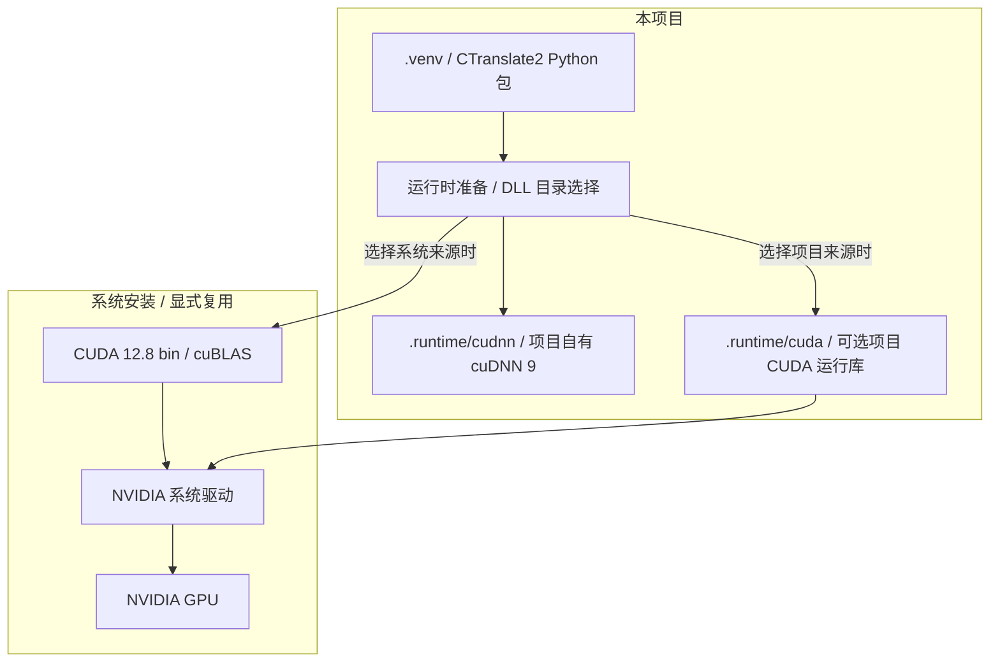

项目可以复用明确指定并验证兼容的系统 CUDA 目录。项目部署不依赖其他项目虚拟环境里的 cuDNN 文件，也不把已有 PATH 中找到的某个 DLL 自动视为本项目的已准备依赖。

运行时准备应校验已选择的目录、库版本和文件，并在真实推理后记录实际加载组合。仅发现文件、成功导入 Python 包或看到显卡，不构成 GPU 识别验收。库缺失或不兼容时，应保留该 GPU 配置的失败证据，不以 CPU 结果冒充 GPU 成功。

后端 wheel 可能自带并主动加载原生 DLL。这些文件归属项目 `.venv`，不属于其他项目运行库。诊断应记录包内 DLL 和显式准备目录内 DLL 的全部实际加载路径。同名库同时加载时，仅凭已加载路径不能证明具体调用绑定哪一个版本；绑定证据不足时，版本字段使用 `null` 并记录限制。

CPU 路径不要求准备 cuDNN 或启动 GPU。GPU 路径的条件与完成判断遵守 P0 Spec；CPU 必验项保持独立。ASR 的 CUDA 选择也不改变本节已选择的 CPU VAD 和唤醒检测运行方式。

原生 DLL 不写入 `uv.lock`，而由本地运行库清单记录。`.runtime`、`.venv` 和模型缓存不进入普通 wheel；分发时通过明确的准备流程或部署镜像提供。uv 不替项目修改系统驱动或全局环境变量。

### 音频、识别与检测

| 部分 | 技术选择与用途 | 选择理由与关键约束 |
| --- | --- | --- |
| 采样数组与 PCM | NumPy，承担声道转换、采样数组及 PCM 与浮点转换。 | 音频与引擎边界使用统一的数据表示，转换不改变采样归属。 |
| 麦克风 | `PyAudio==0.2.14`，通过 PortAudio 枚举、打开、读取和关闭设备。 | 有 Windows 安装包，采集器可独立于识别运行。设备句柄归采集器。 |
| 音频文件 | SoundFile 读取与保存音频；P0 标准 WAV 用标准库 `wave` 校验。 | 文件输入与设备访问分开；P0 保持规定格式，不因读取库支持更多格式就扩大验证范围。 |
| 连续重采样 | `soxr.ResampleStream`，每路输入保留独立转换状态，结束时刷新尾部。 | 直接提供跨块连续处理，避免把每块输入当作独立文件重采样。 |
| 离线语料处理 | SciPy，执行语料转换与增广。 | 数值处理可记录方法和参数；离线增广不进入每次识别流程。 |
| 整段与周期快照 | `faster-whisper==1.2.1`，通过 CTranslate2 执行本地 Whisper 模型。 | 同一后端承担完整音频和固定前缀快照；两种调用使用各自参数，完整结束结果独立执行。 |
| 原生流式 | `sherpa-onnx==1.13.4`，接入 Nemotron 3.5 560 ms INT8 模型。 | 新建解码流按新增音频推进，显式结束并排空；不同会话不共享解码状态。 |
| 双语音活动检测 | `webrtcvad-wheels==2.0.14` 加 Silero ONNX，Silero 使用 CPU `onnxruntime`。 | 两个检测器承担门控与边界判断，保留各自所需帧状态；不依赖 ASR 的 GPU。 |
| Porcupine 唤醒 | `pvporcupine` 与匹配版本的本地模型。 | 通过独立适配器提供唤醒触发，模型、语言和初始化条件在唤醒 Spec 中固定。 |
| OpenWakeWord 唤醒 | OpenWakeWord 的 ONNX 路径，使用本地模型与 CPU ONNX Runtime。 | 复用本地 ONNX 运行路线；检测状态按会话隔离，与 Porcupine 分别安装。 |
| 实时文本与候选 | Python 自有模块，使用 `unicodedata`、`re` 和 `difflib` 等基础工具。 | 稳定、合并、对齐和候选归属沿用核心规则，接入层不另建权威识别状态。 |

核心标准音频仍为 16 kHz、单声道、有符号 16 位小端 PCM。SoXR 转换器在一段连续输入中保留状态；音频处理模块协调输出延迟、帧余量和采样位置。已经结束的音频单元不能接收属于下一单元的转换输出。流式状态与结束刷新使用 [SoXR 的 ResampleStream 接口](https://python-soxr.readthedocs.io/en/latest/soxr.html)。

Whisper 的周期快照输入是固定的完整前缀，不是追加尾块。Nemotron 输入是按顺序递交的新增样本，不将同一历史前缀反复送入原生流。这两条路径通过同一引擎契约表达不同能力。

faster-whisper 的内部 VAD 过滤与核心双 VAD 是不同边界。内部过滤属于引擎解码参数，双 VAD 属于会话门控与自动分句；不能由核心自动分句的选型改写 P0 固定参数。

Silero 使用本地 ONNX 文件和 CPU ONNX Runtime，适配器直接维护所需检测状态。模型获取发生在显式准备阶段，不在核心导入或检测时下载。该检测路径不要求在核心默认依赖中安装 PyTorch。

唤醒为可关闭的能力。关闭时不加载后端或模型；开启时只加载所选后端。指定唤醒模型应与后端版本、平台和语言匹配，不能从后端名称推导已支持全部唤醒词或语言。

### 接入、界面、诊断与部署

| 部分 | 技术选择与用途 | 选择理由与关键约束 |
| --- | --- | --- |
| CLI | 标准库 `argparse`，消费核心事件并输出文本或 JSON。 | 参数解析与识别逻辑分开；命令行工具管理自己创建的输入和运行时。 |
| HTTP 与 WebSocket | FastAPI 定义接口与连接行为，Pydantic 校验外部协议对象。 | 两种网络入口调用同一核心；Pydantic 对象不成为核心会话的依赖。 |
| 服务服务器 | Uvicorn，运行 FastAPI 应用并监听 HTTP 与 WebSocket。 | Uvicorn 承担网络服务器职责，uv 承担环境管理，两者分别安装和使用。 |
| Python 远程客户端 | HTTPX 执行 HTTP 请求，websocket-client 建立 WebSocket 连接。 | 请求与持续连接分别封装；客户端保留协议归属及错误，不持有服务端模型。 |
| 浏览器界面 | React 和 TypeScript，组织实时文本、稳定文本、候选、最终结果、时间线及控制状态。 | 多种结果具有不同更新规则，组件与类型定义便于维护这些关系。 |
| 前端开发与构建 | Vite，使用 npm 管理前端依赖。 | 开发时提供前端开发服务器，发布时生成可由 Python 服务提供的静态资源。 |
| 浏览器采集 | `getUserMedia` 获取设备，AudioWorklet 在音频线程采集，WebSocket 递交音频。 | 音频采集独立于 React 渲染；界面框架不改变核心音频格式和分句规则。 |
| 模型准备 | `huggingface_hub` 获取 Whisper 模型；固定模型包由显式下载入口获取，`hashlib` 校验文件。 | 下载、校验与识别边界分开；确认本地模型后允许离线加载。 |
| 状态与存储 | 会话、任务和解码状态保存在进程内存；模型、语料和诊断记录保存在配置指定的文件目录。 | 当前范围无需持久化会话数据库，文件记录不成为恢复会话的隐含能力。 |
| 日志与评估记录 | 标准库 `logging`；结构化记录使用 UTF-8 JSON 或 JSONL。 | 诊断与评分可关联同一任务，核心不修改宿主日志配置。 |
| 自动化验证 | `unittest`；服务边界使用 FastAPI TestClient 和 HTTPX。 | 从公开行为验证已确认规则，模型与服务替身只用于对应外部故障或时序边界。 |
| 时间与资源测量 | `perf_counter_ns` 记录单调时间，`psutil` 观测进程资源；GPU 资源按验证环境记录。 | 测量口径遵守 P0 Spec，资源不可观测时记录限制，不以自动化通过替代真实模型联调。 |
| 安装与部署 | wheel 独立分发，Windows 本机运行；服务 Docker 镜像分别验证 Linux CPU 与 NVIDIA GPU 组合。 | SDK、CLI 与服务沿用同一包；平台、驱动和模型兼容性按实际组合验收。 |

React 使用服务事件维护界面状态，麦克风和连接资源在独立的客户端模块中管理。AudioWorklet 不通过组件重渲染递交每块采样；界面控制通过公开协议执行。TypeScript 类型说明协议含义，运行时收到的外部事件仍需按协议校验。界面状态和音频线程分别采用 [React 状态组织](https://react.dev/learn/managing-state)与 [AudioWorklet](https://developer.mozilla.org/en-US/docs/Web/API/AudioWorklet)。

浏览器上报实际音频格式，转换责任在协议中明确。服务不能把浏览器的设备采样率当作固定 16 kHz，也不能重复转换已经声明为标准格式的音频。AudioWorklet 的部署环境应满足浏览器的安全上下文要求，本地开发和远程部署分别验证。

前端构建后的静态文件可随 Python 服务包交付，使用者不必运行 Node.js。TypeScript 和 React 不进入 Python 核心的导入依赖，SDK 与 CLI 也不要求启动界面。前端构建能力见 [Vite 文档](https://vite.dev/guide/)；网络服务器职责见 [Uvicorn 文档](https://uvicorn.dev/)。

服务默认一个 Uvicorn worker，该进程持有一个共享运行时。增加 worker 会建立独立运行时及模型资源，不能将多 worker 配置当作共享同一模型的容量扩展。跨进程共享推理不是默认部署方案。

Docker 镜像使用 Linux 的运行库，模型和记录目录通过明确的卷配置提供。Windows 的 DLL 路径不进入 Linux 镜像配置；GPU 镜像单独记录 CUDA、cuDNN、模型和宿主驱动组合。镜像内依赖仍来自声明与锁定结果。

### 技术组合与执行方式

音频输入经过统一转换后进入会话。会话组织音频单元、门控和识别任务，运行时经有界队列执行公平调度。后台工作线程调用引擎，结果通过会话归属检查后进入统一事件出口。

| 执行位置 | 技术与责任 | 关键限制 |
| --- | --- | --- |
| 麦克风采集 | 独立 `threading.Thread`，只采集并递交音频。 | 不等待 ASR 推理后再读取下一块。 |
| 会话协调 | 核心协调输入、控制请求与后台结果，使用线程同步保护状态交接。 | 同一会话的采样、代次和任务登记保持有序，不阻塞执行整段推理。 |
| 推理运行时 | 后台工作线程与有界队列，维护模型实例和公平调度。 | 同一模型实例先按串行调用管理；不同实例的并发数量由真实测量确定。 |
| 网络服务 | Uvicorn 的 `asyncio` 事件循环执行接收与发送，FastAPI 转交核心工作。 | 不在事件循环中执行模型推理或阻塞等待核心结果。 |
| 浏览器 | React 管理界面，AudioWorklet 采集，客户端模块管理网络和音频资源。 | 渲染、设备生命周期与网络事件分别协调，不把界面文本当作核心最终结果。 |

核心队列采用 Python 标准库的队列与线程同步能力，不引入外部消息队列服务。队列容量、过时快照合并、原生增量顺序和最终任务保护沿用本文件的[容量与调度](#容量与调度)约束。

共享模型不等于共享可变解码状态。原生解码流按会话及音频单元隔离，同一模型的调用由运行时序列化。增加隔离实例前应验证后端能力、内存和显存成本，不能默认按连接数复制模型。

当前默认执行方式为工作线程。未来引擎如果确有进程隔离要求，应单独确认其执行器边界、通信和资源关闭方式，不修改宿主的全局进程启动设置。P0 验证可以直接调用适配器，不要求在基线阶段提前实现完整 SDK 调度器。

### 已确认选择与待验证结论

uv、Python 3.12、React、TypeScript、Vite、音频库、检测器运行路线、服务框架及默认线程执行方式是已确认的设计选择。对应能力按项目规划分阶段实现，不因确认技术就视为已交付。

faster-whisper 与 sherpa-onnx 是已选择的普通识别和原生流式验证及接入路线。P0 固定使用 Whisper 多语言 `tiny` 和 Nemotron 3.5 560 ms INT8 模型，CPU 必验及 GPU 条件性对照遵守 Spec。`tiny` 是基线验证模型，不直接成为产品质量默认模型。

产品模型规格、语言覆盖、双实时组合、候选角色、实例复用、容量和等待门槛仍需实测结论。最终、准确实时、极速实时和候选是运行角色，不要求每个角色对应独立模型。

P0 已固定的后端版本保持不变。其他依赖及模型版本在对应功能准备时验证兼容性，再写入其依赖锁定结果或模型清单。未完成验证的组合不能进入已支持矩阵，也不默默升级固定基线。

Kroko 当前暂不接入，不进入正式适配器或基线验证。Qwen ASR 和 FunASR 保持隔离评估，未确认正式接入前不进入核心注册或默认依赖。

### 外部技术的接入边界

| 外部能力 | 接入边界 |
| --- | --- |
| 操作系统音频设备 | 麦克风采集器负责设备访问和释放。 |
| 音频读取与转换库 | 输入和音频处理模块负责转换，向会话交付连续标准音频。具体支持格式由 Spec 确定。 |
| ASR 模型运行库 | 引擎适配器负责调用，运行时负责资源调度。 |
| VAD 与唤醒运行库 | 门控与自动分句负责适配，检测状态按会话隔离。 |
| HTTP / WebSocket 框架 | 服务模块负责协议与连接，不承接识别规则。 |
| GPU 原生运行库 | 运行时准备负责选择和验证加载目录，模型适配器不修改系统环境。 |
| 前端框架与构建工具 | 浏览器模块负责界面和客户端资源，构建产物由服务提供，不进入核心依赖。 |

## 模块

以下名称表示模块职责，不规定最终文件数量或类数量。模块接口应围绕交接内容设计，不以本节名称机械拆分文件。

下表帮助从 PRD 能力定位主要责任。编号只是范围引用，不在此重复功能验收。

| PRD 能力 | 主要结构归属 |
| --- | --- |
| F01—F03 音频输入 | 输入与音频处理，入口拥有设备或读取资源，会话拥有转换和标准样本。 |
| F04、F06 会话与结果 | 会话与音频单元管理、统一事件出口和运行时任务归属。 |
| F05、F12、F20 分句与唤醒 | 门控与自动分句提出边界，会话执行音频切分与状态变化。 |
| F07—F11、F13 实时与文本 | 运行时执行识别，实时文本处理维护观察、稳定和合并；会话检查归属。 |
| F14—F19 候选与继续 | 候选与恢复管理保存请求，会话提供音频和顺序屏障，运行时执行推理。 |
| F21—F23 接入 | 公开接口、CLI、服务协议及远程客户端，沿用核心行为。 |
| F24 共享服务 | 服务管理连接，运行时管理模型和公平队列，会话隔离状态。 |
| F25 浏览器 | 客户端采集与显示、服务协议契约，核心不依赖界面。 |
| F26 安装与模型 | 模型准备、可选依赖和发布入口，保持离线识别及隔离加载。 |
| F27 日志与示例 | 统一诊断契约与外围使用示例，不向核心反向引入示例依赖。 |

### 公开接口与组装入口

公开接口提供运行时准备、会话控制、音频提交和结果消费能力。SDK、命令行和服务使用同一组核心语义。

创建运行时的入口负责合并配置、选择引擎适配器和组装依赖。模型实例的创建与使用由运行时协调，不能由每个会话自行加载。

公开接口将请求交给状态拥有者。公开接口不再维护一份独立的音频单元状态，也不替代会话判断结果有效性。

接口签名、同步或异步形式、上下文管理方式和具体错误类型由对应 Spec 定义。接口形式应满足宿主程序控制资源的要求，不能依赖全局单例运行时。

### 音频输入

音频输入模块负责麦克风采集、文件读取和标准输入读取。麦克风采集器拥有设备句柄，并负责启动、读取、停止和释放设备。

程序直接送入音频时，不需要加载麦克风依赖。识别服务接收外部音频，不创建服务端麦克风采集器。

输入模块只提供音频和格式信息。语音断句、识别调度和识别结果的归属由核心模块负责。

输入模块应处理自身的读取失败，并通过接入入口报告。输入模块不能把设备读取失败伪装成正常静音，也不能自行触发模型识别来补偿输入故障。

### 音频处理

音频处理模块负责格式校验、声道转换、重采样和音频帧整理。每个会话拥有独立的转换状态及未凑满一帧的音频。

核心标准音频采用 16 kHz、单声道、有符号 16 位小端 PCM。PCM 指未压缩的采样数据。模型需要浮点音频或其他采样率时，引擎适配器负责模型边界上的转换。

转换状态应跨输入块保留。输入块的边界不应改变音频的连续性。结束输入时，音频处理模块应明确交付尾部剩余采样。

音频位置按采样数记录。重采样后的音频单元、实时识别和最终识别使用同一条核心音频时间线。

音频处理模块不判断一句话是否已经结束。它向会话提供标准音频与音频位置，由会话决定如何组织音频单元。

### 会话与音频单元管理

会话模块拥有输入配置、标准音频缓冲、音频单元标识和会话代次。VAD、唤醒、文本与候选状态作为会话内子状态管理，分别由对应模块维护。会话模块负责判断结果是否仍属于有效工作。

会话组织当前接收中的音频单元，并保留已结束音频单元与其未完成任务的关联。上一句等待最终结果时，下一句可以继续接收音频；两句不能共用可变音频缓冲。

手动结束和自动分句都通过会话模块结束音频单元。接入层不直接修改 VAD 状态或内部音频缓冲。

音频单元结束时，会话先刷新转换余量并确认输入消费，再固定完整音频和最终任务归属。原生实时流收到剩余增量及结束请求，以完成实时解码；普通最终识别另以完整封口音频执行，不把流式实时文本当作最终文本。

仅候选引擎模式由有效整轮候选承担结束结果，音频版本改变时重新生成整轮候选。最终策略由运行配置明确选择，不能由接入层隐式替换。

核心继续接收后续音频，并在容量内组织下一句。后续采样不能改写已提交任务的音频，也不能进入上一句的解码状态。

重置更新会话代次。取消使目标音频单元或任务失效，具体影响范围由 Spec 定义。会话在发布前检查代次和失效范围，丢弃旧结果；接入层不能自行扩大取消范围。

音频输入、控制请求和后台结果可能并发到达。会话模块应协调这些操作，保持音频单元状态和任务登记一致。具体协调机制由实现设计确定。

### 门控与自动分句

自动分句使用 VAD、语音开始前的缓冲和静音确认。音频单元结束前的缓冲用于保留完整音频；语音开始前的缓冲用于补回检测延迟期间的音频。

门控与自动分句模块向会话提供语音边界判断。会话负责创建和结束音频单元，本模块不直接发布最终文本或调用 ASR 引擎。

有状态的 VAD 实例或检测状态按会话隔离。共享检测模型的不可变权重，不等于共享检测状态；是否能够共享，应按所选运行库验证。

如果调用程序选择手动结束，核心仍使用同一套音频单元结束和最终识别流程。关闭自动分句不应使程序接入依赖麦克风采集器。

阈值、静音时长、最大音频单元时长和尾部音频处理属于功能行为。它们应在对应 Spec 中确认，不在接入层各自设置一套规则。

双检测器、最短录音、最小间隔和结束静音确认共同产生边界判断。前置缓冲记录检测信息与样本位置，裁剪复用这些记录，不重复启动一套独立 VAD。

句末标点策略使用稳定观察和有效词时间戳向会话提出切分位置。会话统一切分左右音频，固定左侧、保留右侧。检测器和文本处理器都不能私自截取最终音频。

回溯边界也通过相同的样本切分入口执行。切分后的有效样本归属可追踪；补零、前置静音和实际语音分别标记。

唤醒门控按会话保存检测状态。Porcupine 与 OpenWakeWord 是两个后端，向门控返回触发信息，不直接启动推理或发布结果。激活延迟、唤醒后超时、触发音频裁剪和后续窗口由同一门控管理。

定时任务绑定会话代次及门控代次。重置、取消或关闭使旧定时任务失效；单个会话的窗口不能改变共享模型或其他会话门控。

下图是唤醒启用时的逻辑门控状态。箭头表示事件引发的转换，不规定公开枚举。后续窗口仅在配置启用时存在。

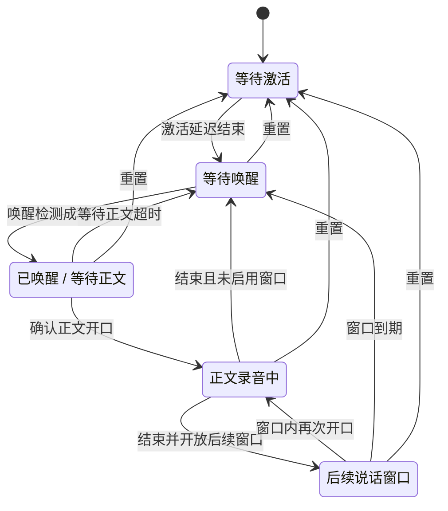

关闭唤醒时，输入按所选自动或手动模式进入会话。手动模式的整轮结束仍由调用方控制，不能让唤醒窗口隐式完成整轮。

### 实时文本处理

本模块维护准确实时观察、极速实时观察、稳定前缀、待定文本和合并状态。状态按会话、音频单元及代次隔离，不与模型实例一起共享。

每次观察关联任务来源、输入音频版本和递增观察序号。观察不属于当前音频单元、序号过旧或输入已失效时，不进入稳定或合并历史。

稳定器根据有效观察、实际音频推进和等待时间提交稳定增量。相同文本重复返回但音频未推进，不能直接等同于新增稳定证据。

双实时合并以准确正文为基准，仅接受有可信锚点的极速尾部。正文更新时重新判断尾部归属，限制尾部长度和模糊匹配范围。原始极速文本可作为独立诊断来源，不能直接覆盖准确正文。

下图表示文本数据关系。最终结果独立于实时合并文本；稳定与合并分别保留状态。具体观察来源、锚点规则与中文对齐方法由 Spec 确认。

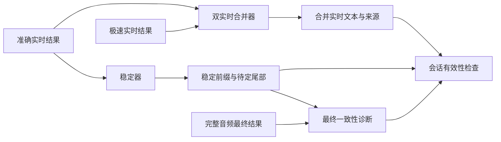

一个稳定器实例只消费明确选定的观察流。准确与极速结果不能交替当作同一模型观察，造成虚假的重复或稳定证据。更换显示策略时，状态切换规则由对应 Spec 说明。

声学边界检测只产生识别触发信号。会话登记补识别计划，运行时执行任务；边界检测器不创建私有模型工作者。

静音提前推理产生带音频版本的候选最终任务。继续讲话后，旧版本不能成为本轮最终结果。动态句尾等待只向门控提供策略参数，不绕过会话封口流程。

词或段时间戳从引擎返回，转换到该任务的标准音频范围。没有相应能力时，不能执行依赖该时间戳的切分。锚点分词与规范化应按语言验证，不能把空格分词规则直接当作中文规则。

### 候选与恢复管理

本模块维护候选请求、候选快照、候选结果有效性和同轮继续边界。会话持有整轮音频，本模块按会话授权取得不可变快照，不维护另一份可变正文缓冲。

候选任务与实时、最终任务共用运行时。候选管理不会自行加载模型，也不会在服务事件循环中执行阻塞推理。

两种候选具有不同输入和结果契约：

| 策略 | 任务输入 | 结果处理与可信范围 |
| --- | --- | --- |
| 尾部修复候选 | 有限尾部快照及独立记录的实时边界文本。 | 尾部 ASR 与边界文本对齐，返回修复文本和匹配状态。对齐失败不声称完整转写。 |
| 整轮候选 | 请求时保留的完整整轮标准音频。 | 文本直接来自整轮 ASR。Live 信息只作诊断，不替代模型输入。 |

尾部修复失败时，可保留边界实时文本，并明确失败状态。整轮候选失败时返回相应失败，不能借用 Live 文本冒充本次 ASR 成功。

快照记录原始覆盖范围、音频版本和请求代次。引擎尾帧处理需要补零时，补零不改变真实覆盖终点。常规候选与提示性提前候选使用显式策略，限制重试次数；具体时长和适用引擎由 Spec 验证。

候选请求可以被更新请求替代。进入推理前及发布前都检查归属，避免旧请求占用尚可撤销的资源或发布过期结果。模型调用不能中断时，继续由运行时管理直至释放。

同轮继续保留完整音频，记录已接受标准 PCM 的精确边界，并更新候选／恢复代次。它不更新整轮标识，不重置重采样状态，也不清除整轮历史。

恢复边界与候选覆盖范围是两个概念。恢复边界用于说明新的候选归属；其后的整轮候选仍识别整轮快照。尾部修复策略使用自己的范围说明。

会话序列化恢复请求与音频接受。恢复确认以该操作确认时的已接受样本为准，而不是推理完成时间或客户端估算时间。

恢复应答与后续结果经同一核心有序出口交付。恢复应答之前不能发布属于新恢复代次的结果；旧候选在恢复后不能覆盖新的候选状态。

候选归属有效与覆盖当前音频是两个判断。归属检查会话代次、音频单元、请求及候选策略；覆盖判断检查音频版本和样本范围。

接收新音频不改变旧快照。请求仍有效时，旧快照可以作为注明覆盖范围的候选结果交付，但不能宣称覆盖最新音频。仅候选引擎模式只能复用覆盖封口版本的整轮候选，不能复用尾部修复文本作为整轮最终识别。

延后整轮修正是显式任务，关联原结果及固定音频。完成通知不默认永久保留整轮；为修正保留的音频由已确认契约限定容量和存活范围。修正属于另一个显式任务，不能重复终结原轮工作。

### 推理执行与调度

运行时模块拥有模型实例、推理任务队列和后台执行资源。运行时模块负责加载、预热、调度、超时控制和关闭。

音频采集与模型推理使用独立执行任务。HTTP 和 WebSocket 的异步事件循环不直接执行阻塞的模型推理。

输入缓冲、推理队列和结果队列均设置容量边界。音频容量按采样数或时长计算，避免输入分包大小改变实际容量。

服务端共享已加载的模型资源。各会话独立保存音频、VAD 状态、音频单元状态和流式解码状态。模型共享不表示这些状态可以共享。

运行时按会话调度识别任务，避免一路持续输入无限占用待执行队列。调度应按会话公平分配机会，并区分最终、准确实时、极速实时和候选任务。具体算法、权重和优先级由 Spec 及性能基线确认。

非流式实时任务可以保留最新待执行快照；可替代候选请求按候选代次合并。最终任务、流式音频增量和终结结果不采用普通实时替换策略。

最终、实时和候选任务可以使用不同执行通道，但仍属于一个运行时资源管理范围。共享模型实例有统一并发门限，不能因为使用多个通道就并发调用不安全实例。

运行时接受任务与开始模型调用是两个阶段。任务的归属应在结果可能返回前登记。运行时将执行结果交还所属会话，不直接向终端或连接发送文本。

### ASR 引擎适配器

引擎适配器封装模型运行库。适配器负责模型参数校验、模型输入转换、推理调用和识别结果转换。

普通识别接口接收一段音频并返回统一结果。统一结果包含识别文本，并允许附带引擎提供的语言和时间信息。引擎未提供的信息不应伪造。

原生流式识别作为单独的引擎能力。支持这种能力的引擎创建独立解码会话，按顺序接收新增音频，并在音频单元结束时完成解码。

不支持原生流式识别的引擎可以周期性转写音频快照。运行时负责控制调用频率和队列容量。两种方式都可以产生实时文本，但不应混用音频递交方式。

引擎应说明模型实例是否允许并发调用。运行时按引擎能力串行调用或隔离实例，不假定所有模型运行库都能并发执行。

引擎能力说明应区分整段识别、原生流式、词／段时间戳、语言检测、取消、预热、并发和关闭。不支持中断模型调用时，核心仍应能使任务逻辑失效并阻止迟到结果发布。

### 结果事件与消费

会话模块确认结果归属后，核心通过统一事件接口发布结果。接入层将核心事件转换为终端输出、SDK 结果或服务消息。

结果应区分原始实时、稳定增量、合并实时、两种候选、最终、完成、取消和失败，并能定位会话与音频单元。同一会话的事件按约定顺序输出。事件字段由 Spec 定义；共享约束是同一输出范围有序，正常最终先于完成，同轮继续应答先于新恢复代次结果。

结果消费机制负责排队与交付，不判断语音边界。识别结果的有效性由会话判断，事件发送失败由消费入口处理。

慢调用方的事件队列也设置容量边界。核心或接入层按各自队列契约合并过时实时文本，但不能跨会话、音频单元、来源或代次合并。最终、完成、恢复应答和明确失败受终结事件保护，不能当作普通实时更新替换。

发布有效性与输出序号由有序出口协调。合并、移除过时事件后再分配实际输出序号，避免内部任务序号被误当作发送序号。恢复、取消或重置应同时处理尚未交付的旧候选。

核心事件队列与服务发送队列是不同资源。如果服务增加发送缓冲，服务应对该缓冲负责，不能认为核心有界就能保证整条输出链路有界。

### 命令行工具与识别服务

命令行工具负责参数解析、输入选择、终端文本和 JSON 输出。JSON 指结构化的数据格式，供其他程序读取。

命令行工具协调自身输入、会话和运行时的生命周期。输入停止后，命令行工具按已确认的关闭行为处理未完成工作，再关闭自己拥有的资源。

服务模块负责 HTTP 请求、WebSocket 连接、协议校验和连接清理。服务模块将各连接的音频送入独立会话，将核心结果发送给对应调用方。

服务持有共享运行时。连接结束时，服务清理该连接的会话和发送资源，不因单个客户端断开而关闭其他会话使用的模型。

服务就绪状态由运行时的模型加载和运行状态决定。进程启动不表示模型已经可用。模型就绪与当前是否还有容量应分别判断。

服务协议有独立版本，入口校验音频包格式、会话绑定和输入连续性。网络音频序号、标准样本位置与输出事件序号分别使用，不能互相代替。

服务模块承担 Bearer Token、监听范围、TLS 与代理接入配置。凭据不进入识别状态或结果事件。存活、模型就绪和容量查询分别反映对应状态。

运行配置分为共享模型启动配置、会话配置和运行管理配置。修改时说明对活动会话、新会话或下次启动生效；不允许通过改会话参数重建所有共享模型。

### 远程客户端与浏览器

Python 远程客户端负责连接、音频发送和服务事件转换。客户端不依赖服务内部类，不通过远程属性调用直接修改会话缓冲。

浏览器负责本机采集、输入音频格式处理、协议调用及展示。采集格式到核心格式的转换归属应唯一；若客户端转换，服务仍校验声明格式，不再次假设其原始采样率。

前端分别保存可变实时显示、稳定显示、候选及最终结果引用。收到来源或覆盖范围不同的结果时，按协议更新相应显示，不把所有文本简单追加成最终正文。

复制、展示清除和后台重置是不同操作。界面使用对应公开控制，不直接清除服务端任务或改变候选代次。

浏览器的 RMS 停顿判断可以请求提示性候选，候选策略仍由核心执行。界面不在本地拼接一套独立权威候选结果。

热键听写与音频保存示例同样调用公开接口。正式模块不依赖示例运行环境，示例不得补齐安装包缺失能力。

### 跨模块交接

下表描述交接责任，不定义具体数据类型或接口字段。

| 交接边界 | 交出的内容 | 接收方的责任 |
| --- | --- | --- |
| 输入模块或服务 → 公开接口 | 音频、格式信息和所属会话。 | 校验公开输入契约，将音频交给目标会话。 |
| 音频处理 → 会话 | 连续的标准音频与采样位置。 | 维护缓冲和音频单元归属。 |
| 门控与自动分句 → 会话 | 唤醒状态或语音、标点边界判断及样本位置。 | 按模式创建、切分或结束音频单元。 |
| 实时文本处理 → 会话 | 带观察归属的稳定、合并或诊断结果。 | 确认有效性并经统一出口发布。 |
| 候选与恢复管理 → 会话 | 快照请求、候选状态或恢复屏障。 | 关联标准音频和任务，协调输入与有序发布。 |
| 会话 → 运行时 | 任务归属，以及固定音频快照或有序流式增量。 | 检查容量、调度任务并维护执行资源。 |
| 引擎适配器 → 运行时 | 统一识别结果或可判断的执行失败。 | 完成任务执行记录，将结果交还所属会话。 |
| 会话 → 结果事件与消费 | 已确认有效的结果事件。 | 按事件契约交付，处理结果缓冲容量。 |
| 公开接口 → 状态拥有者 | 结束、取消、重置或关闭请求。 | 改变自身状态，并向受请求影响的资源拥有者交接清理工作。 |

## 依赖规则

### 模块依赖图

下图的箭头表示代码依赖方向。它不表示音频流向或结果返回方向。引擎适配器依赖统一引擎接口，运行时也依赖该接口；具体适配器由组装入口提供。

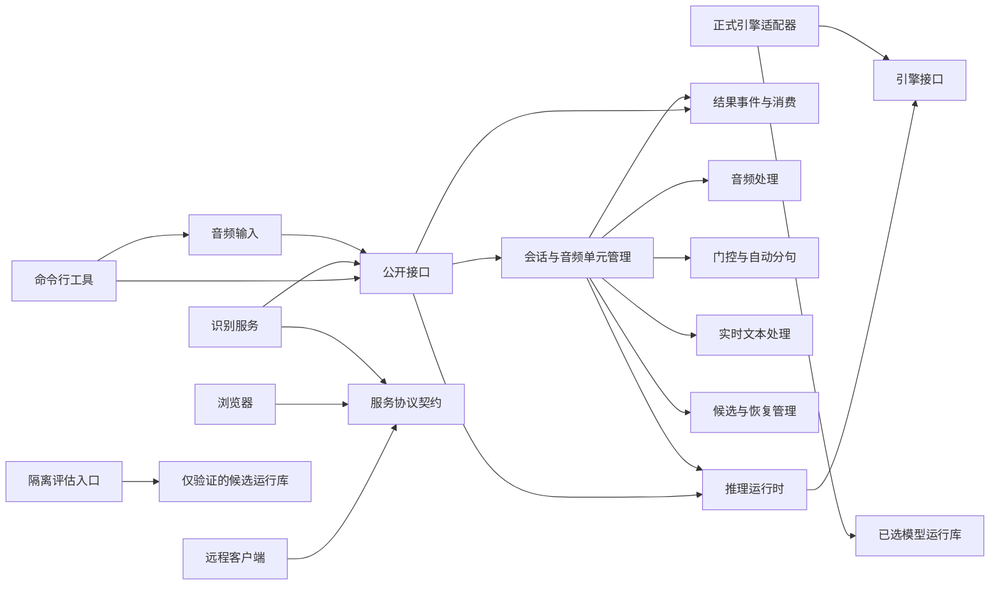

运行时向会话交还结果，不要求运行时依赖具体会话实现。结果交接应使用核心内部约定，不让模型适配器读取会话内部缓冲。

- 命令行工具和识别服务通过核心公开接口调用识别能力。
- 核心会话逻辑不依赖命令行展示、HTTP 或 WebSocket 实现。
- 音频输入模块可以调用核心输入接口，核心不要求存在麦克风设备。
- 会话模块使用音频处理能力，并向运行时提交推理任务。
- 运行时通过引擎接口调用模型，引擎适配器不依赖会话、命令行或服务实现。
- 接入层不绕过运行时创建私有模型任务队列，也不直接读取会话内部缓冲。
- 正式模块不依赖示例程序或只验证入口；示例程序调用正式公开接口。
- 实时文本和候选管理使用核心任务与音频契约，不依赖服务连接或模型运行库。
- 候选评估依赖不通过工厂注册进入正式能力查询；批准接入后再建立正式适配。
- 外部输入在入口校验。内部模块按已建立的契约交互，不重复解析外部协议。

### 代码与评估的归属

正式识别实现与评估程序应在目录、依赖和发布边界上分开。评估程序调用识别实现，识别实现不得依赖评估程序或测试。

| 目录 | 职责 | 发布边界 |
| --- | --- | --- |
| `src/realtime_asr/core/` | 音频规则、识别结果、错误和后端适配；后续会话与识别流程按对应 Spec 建设。 | 属于正式 Python 包。 |
| `src/realtime_asr/runtime/` | 模型准备与校验、GPU 和原生运行库支持；推理资源与调度按对应 Spec 建设。 | 属于正式 Python 包，不依赖语料、评分或验证矩阵。 |
| `evals/` | 语料准备、识别效果评估、性能观测和阶段验收。阶段专用入口放在对应子目录，例如 `evals/p0/`。 | 使用项目源码与开发依赖，不进入 wheel。 |
| `tests/` | 已确认行为的自动化测试，按核心、运行支持和评估工具分组。 | 不进入 wheel。 |

评估代码为识别结果补充样本、试次、测量和评分归属。这些评估字段不得成为核心音频输入或识别结果的必填条件。评估中的模型池负责矩阵复用与预热，不能直接充当产品运行时。

wheel 的包发现范围应限定为 `src/realtime_asr/`。源码分发包可保留评估与测试源码；模型、语料、运行库和验证产物独立保存。实际实现目录及使用命令见 [README](../README.md#代码结构)。

## 数据流

### 音频与结果流向

下图的箭头表示数据传递。各类识别任务由同一运行时管理。任务节点表示工作类型，不规定模型数量。

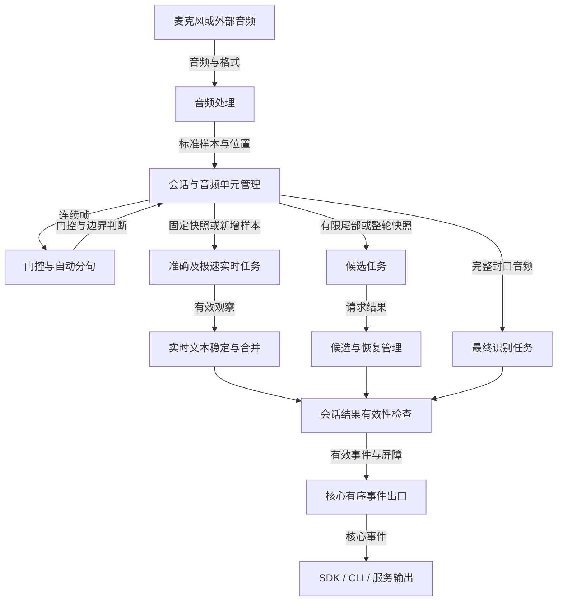

会话决定音频属于哪一句，运行时决定任务何时执行，引擎负责转写。会话再决定返回结果是否仍然有效。输出入口只处理属于自身使用范围的事件。

### 麦克风连续识别

1. 命令行工具建立运行时和识别会话。
2. 运行时加载模型，并报告就绪状态。
3. 麦克风采集器读取音频，将音频送入核心输入接口。
4. 音频处理模块转换采样格式，并交付连续音频帧。
5. 会话模块维护 VAD 和预录缓冲，组织当前音频单元。
6. 运行时执行实时识别，会话模块发布有效的实时结果。
7. 门控与自动分句确定结束边界，会话模块刷新尾部并固定完整音频，结束实时流。
8. 运行时完成该音频单元的最终识别，会话模块发布对应的终结结果。
9. 后续音频继续进入会话，命令行工具展示后续结果。

音频单元音频固定后，后续输入不修改已提交的音频。最终识别可以与下一句的采集同时运行。

下图展示音频单元 A 的最终识别与音频单元 B 的输入交叠。箭头表示请求或结果交接，两个并行分支表示输入处理不等待最终识别完成，不承诺模型同时执行多个调用。

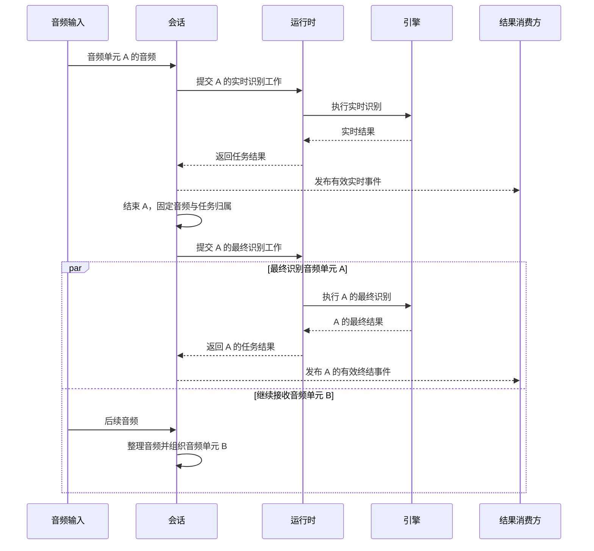

会话应同时保留音频单元 B 的接收状态和音频单元 A 的任务关联。单个“当前音频单元”变量不能同时承担这两项职责。

### 程序提供音频

1. 调用程序通过 SDK 或服务接口提交音频。
2. 接入层校验调用格式，将音频交给对应会话。
3. 核心沿用音频处理、音频单元组织和识别链路。
4. 自动分句或调用程序的结束请求结束当前音频单元。
5. 核心发布识别结果，接入层返回给调用程序。

文件和标准输入读取也进入这条链路。输入块大小只影响传输，不改变音频单元归属和采样连续性。

HTTP 完整音频请求使用完整音频识别行为，不要求先运行自动分句，也不要求输出实时文本。服务仍通过核心提交最终识别工作，并接收对应的终结结果。

### WebSocket 接入

WebSocket 接入增加协议解析和连接管理，不增加独立的语音识别流程。接收音频与发送事件是两个可独立推进的任务。

下图的箭头表示协议消息或核心接口交接。音频接收分支不需要逐包等待识别结果。

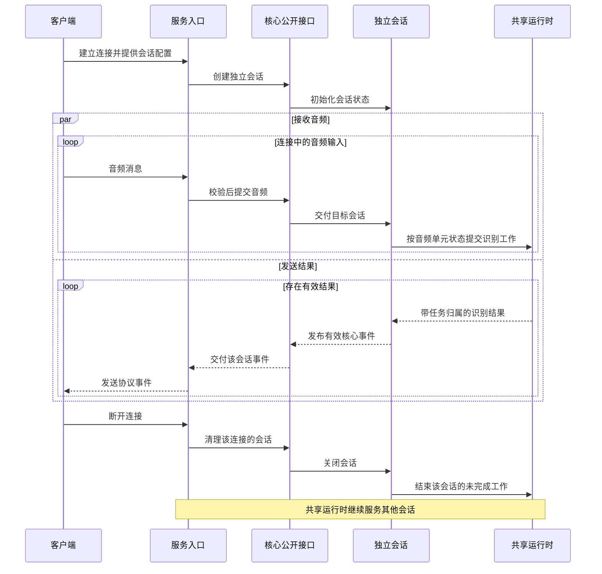

核心音频容量限制、推理容量限制和服务发送容量限制应分别处理。连接断开后，服务停止向该连接交付事件；已运行模型任务仍按会话失效与资源清理规则处理。

### 两种候选的音频与文本来源

下图的箭头表示音频或文本数据传递。实时边界文本只参与尾部修复；整轮候选的模型输入始终来自完整音频快照。

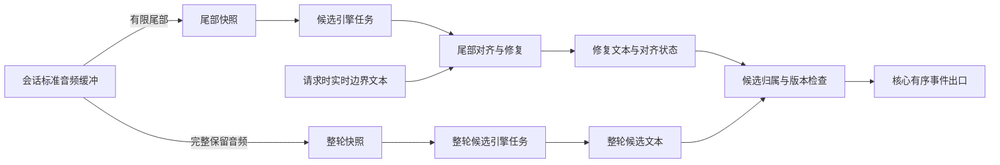

任务开始前冻结输入和版本，执行结果返回后检查该请求是否仍有效。尾部修复不能升级成未经实际识别的整轮文本；整轮候选不能退化为 Live 文本兜底。

### 同轮继续与旧候选隔离

下图展示候选运行中发生同轮继续的路径。箭头表示控制或任务交接。候选代次 E 与 E+1 属于同一个整轮，整轮音频没有被清空。

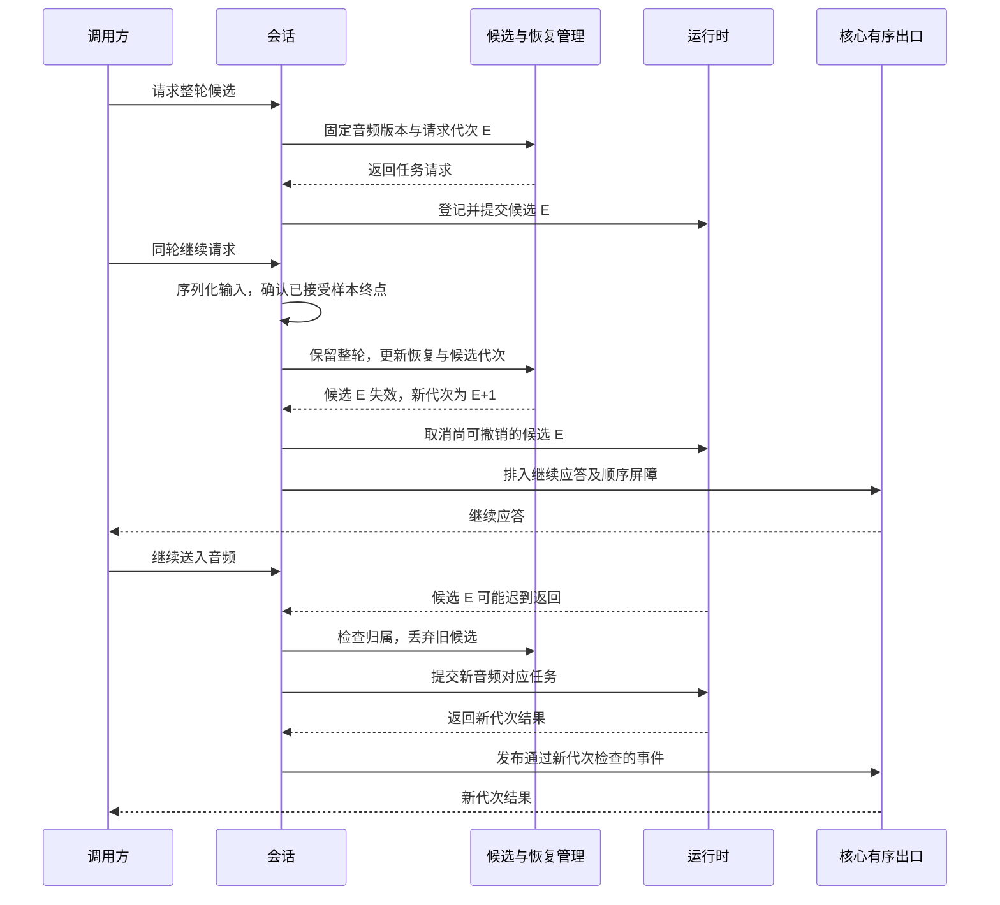

有序出口还检查排队事件，不能只在模型返回时检查一次。已进入服务发送队列的候选，同样保留可判断的归属，服务与核心共享失效信息。

### 最终封口与候选复用

最终封口先停止该音频单元继续接受输入，再刷新转换余量，确认消费范围。实时流排空、最终推理和结果发送共享已确认的结束时限，不各自无限等待。

普通最终策略使用完整封口音频执行最终任务。静音提前结果只有覆盖版本一致时才可采用。仅候选策略检查有效整轮候选是否覆盖封口版本，失配时重新提交整轮候选。

正常成功路径先交付一个最终结果，再交付完成事件。无语音、取消、超时或失败有对应终结状态，不伪造成功文本。是否允许完成后显式整轮修正，由修正契约限定保留期限和关联方式。

### 取消与重置

取消或重置时，会话模块先使旧工作失效，再请求运行时取消尚未完成的任务。已经进入模型调用的任务可能迟到返回；结果发布仍需检查会话代次。

下图展示取消发生在模型调用期间的交接。箭头表示控制请求和任务结果，G 表示取消前的任务代次。

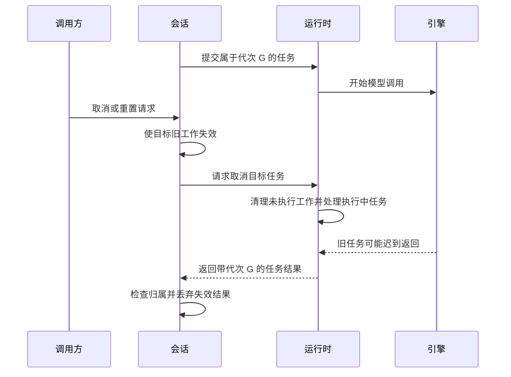

使结果失效不等于模型调用已经停止。运行时仍拥有执行中的资源，并应在调用退出或清理完成后释放资源。

发布前的有效性检查也应覆盖取消与结果同时到达的情况。已进入输出队列的事件如何处理、取消影响哪些音频单元，由对应 Spec 明确，不能仅依靠模型适配器的取消能力。

## 运行结构与资源归属

### 共享与隔离

下图展示逻辑资源归属。实线箭头表示持有或管理，虚线箭头表示会话向运行时提交工作。图中不规定对象数量或线程数量。

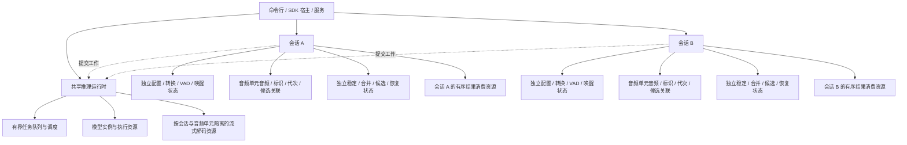

共享运行时默认对同一个模型实例串行调度调用。需要增加隔离实例时，先验证引擎能力、资源占用和任务归属，再确定并发配置；不能从共享模型推导同一实例可并发调用。

原生流式解码资源的逻辑归属是具体会话和音频单元，物理创建、调用与释放由运行时和引擎适配器负责。会话失效后，运行时不能把旧解码状态交给新音频单元继续使用。

### 状态与资源拥有者

| 状态或资源 | 拥有者 | 创建与使用 | 结束与释放责任 |
| --- | --- | --- | --- |
| 麦克风设备句柄 | 麦克风采集器。 | 采集器启动设备并读取音频。 | 采集器停止并释放设备，命令行协调关闭。 |
| 文件或标准输入读取资源 | 对应输入读取器。 | 读取器按输入契约交付音频。 | 读取器停止本次读取并清理自己创建的资源。 |
| HTTP 请求或 WebSocket 连接 | 服务入口。 | 服务绑定请求、连接与目标会话。 | 服务清理对应会话和发送资源，不关闭共享运行时。 |
| 合并后的运行配置 | 创建运行时的入口。 | 入口合并默认值与调用参数，运行时按确认配置准备。 | 配置随其运行时使用范围结束。 |
| 会话配置 | 会话。 | 创建会话时确定，不通过改动共享模型配置影响其他会话。 | 会话关闭后释放。 |
| 重采样状态与帧余量 | 会话内的音频处理状态。 | 随连续输入保留，结束输入时交付尾部采样。 | 重置或关闭时按输入契约清理。 |
| VAD 状态与语音开始前缓冲 | 会话内的门控与自动分句。 | 只处理本会话的音频。 | 会话重置或关闭时清理。 |
| 接收中的音频单元音频、标识与代次 | 会话。 | 会话组织音频并处理结束请求。 | 会话负责结束、失效与释放。 |
| 已提交任务的固定音频 | 任务引用，会话管理原始缓冲。 | 快照不可变，记录真实样本范围。 | 无活动任务或修正引用后释放；取消后不提前释放仍被模型读取的音频。 |
| 推理队列和后台执行资源 | 运行时。 | 运行时检查容量并调度。 | 运行时取消、排空或关闭，报告实际清理结果。 |
| 模型实例 | 运行时；适配器封装实例。 | 按模型配置加载、预热并调用。 | 运行时协调适配器释放。 |
| 原生流式解码资源 | 运行时管理，关联具体会话与音频单元。 | 按顺序接收增量，结束时完成解码。 | 最终完成、取消或会话关闭后清理。 |
| 任务归属与结果有效性 | 会话。 | 关联会话、音频单元、任务和代次。 | 会话使目标工作失效，拒绝迟到结果。 |
| 稳定与合并历史 | 会话内实时文本处理。 | 按音频单元、观察来源和代次独立维护。 | 音频单元结束、重置或策略切换时清理。 |
| 候选请求与恢复边界 | 会话内候选与恢复管理。 | 固定快照版本、请求关联、候选代次与接受样本边界。 | 请求失效或单元结束时清理，延后修正按契约限时保留。 |
| 唤醒状态与窗口计时 | 会话内门控与自动分句。 | 后端状态独立，计时器绑定门控代次。 | 重置或关闭先使计时失效，再释放状态。 |
| 核心结果缓冲 | 核心结果消费机制，按会话隔离。 | 接收有效事件并按契约交付。 | 消费结束时清理，容量不足按 Spec 处理。 |
| 终端输出或服务发送缓冲 | 命令行或服务入口。 | 将核心事件转换并交付给使用者。 | 对应入口处理慢消费、断开和输出失败。 |

资源拥有者负责资源的完整生命周期。使用某个资源不代表可以关闭它；会话结束不能直接释放其他会话仍在使用的模型。

### 执行责任

| 执行角色 | 负责的工作 | 不能承担的工作 |
| --- | --- | --- |
| 音频采集或读取任务 | 获取音频并交给公开接口，处理输入故障。 | 等待模型推理完成后才读取下一块音频。 |
| 会话处理 | 整理音频、维护音频单元、登记任务、处理控制请求和返回结果。 | 阻塞执行完整模型推理。 |
| 推理执行资源 | 调用模型、完成解码并返回执行结果。 | 直接发送网络消息或改变终端展示。 |
| 结果消费任务 | 按契约输出事件，处理消费者速度和输出失败。 | 改变音频单元归属或重新定义最终文本。 |
| 服务事件循环 | 接收协议消息、转交控制请求、发送结果。 | 直接执行阻塞模型调用。 |

这些角色需要独立推进，但不要求一角色对应一线程。默认使用后台推理工作线程、独立麦克风采集线程和服务 asyncio 事件循环；具体线程数量及队列容量由对应功能验证确定。需要进程隔离的引擎另行确认执行器设计。

### 容量与调度

所有积累音频、任务或事件的边界都应有容量限制。服务不能只限制连接数量，却允许单个会话无限积累音频。

| 工作或数据 | 允许的处理策略 | 应保持的约束 |
| --- | --- | --- |
| 尚未接收的音频 | 在接收前检查容量，拒绝或按 Spec 结束输入。 | 不把容量不足伪装成成功接收。 |
| 尚未执行的非流式实时快照 | 合并过时快照，保留当前仍有效的最新快照。 | 不跨会话、跨音频单元或跨代次替换。 |
| 原生流式音频增量 | 在容量内按顺序处理；容量不足按 Spec 报告。 | 不按快照策略丢弃中间增量。 |
| 最终识别任务 | 在接收前检查容量，接受后保留到明确终结。 | 不静默丢弃，也不被实时快照替换。 |
| 待执行候选 | 按同一音频单元的请求与候选代次替代。 | 不将尾部修复与整轮候选混为同一策略；运行任务仍归运行时。 |
| 整轮保留与延后修正音频 | 按输入时长、任务引用和修正存活范围限制。 | 完成事件不等于永久存档，不因迟到任务提前释放引用。 |
| 过时的实时文本 | 输出前可以按事件契约合并。 | 不改变最终结果含义或事件归属。 |
| 最终、完成、恢复应答与失败事件 | 保留到交付，或按 Spec 明确报告无法交付。 | 不当作普通实时更新覆盖。 |

任务容量、音频容量和输出容量分别计算。某个任务完成不代表慢消费者已经释放结果容量。

容量数值、调度优先级和等待时限应来自运行基线与对应 Spec。架构只规定边界和责任，不预设未经测量的并发承诺。

## 生命周期与责任交接

### 运行时生命周期

下图表示逻辑状态转换。状态名称用于说明责任，不规定公开枚举或函数名。

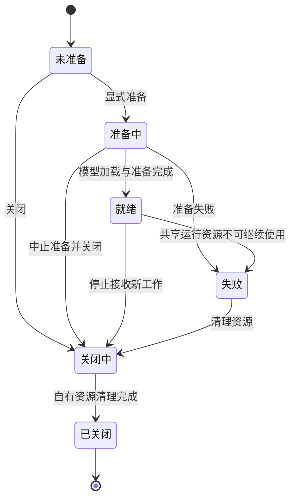

只有模型准备完成且运行资源可用，运行时才报告就绪。就绪不保证任务队列永远有空位；接收工作时仍应检查容量。

加载失败后，应清理已创建的资源并报告失败。是否支持重新准备或自动恢复，需由相应 Spec 确认；图中不承诺自动恢复。

进入关闭中后，运行时停止接受新工作。关闭等待应有时限。超时或清理失败应可观察，不应无限等待，也不应报告资源已经释放。

### 音频单元与最终工作生命周期

下图表示一条音频单元从接收音频到最终终结的逻辑流程。实时识别任务可以在“接收中”产生，不在图中逐一展开。

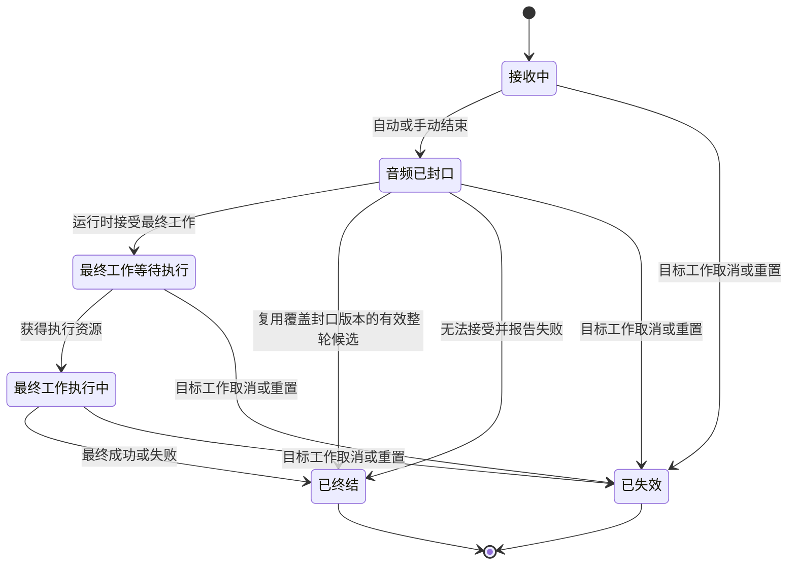

音频单元 A 的音频固定后，会话可以开始接收音频单元 B。A 的最终工作等待或执行期间，A 与 B 的状态分别维护。

排队分支可以执行普通最终识别，也可以执行仅候选引擎模式下的新整轮候选。复用分支仍先交付最终结果，再交付完成事件，不跳过终结语义。

“已失效”表示旧工作不再允许产生有效识别结果，不表示后台调用已经退出。取消事件、重复结束和重复取消的具体行为由 Spec 定义。

一次已接受的最终工作应得到明确的终结结果。会话负责避免同一工作被后台结果和取消请求分别终结两次。

### 候选任务生命周期

候选是音频单元内的任务，不是新的会话。下图表示其逻辑状态，失效与物理退出分别管理。

```mermaid
stateDiagram-v2
    state "快照已固定" as Snapshot
    state "等待执行" as Waiting
    state "执行中" as Running
    state "结果有效" as Valid
    state "结果失败" as Failed
    state "已失效" as Invalid
    state "有更新音频 / 仅代表旧快照" as OlderSnapshot
    state "可复用为结束结果" as Reusable
    [*] --> Snapshot
    Snapshot --> Waiting: 任务接受
    Snapshot --> Failed: 任务未被接受
    Waiting --> Running: 获得执行资源
    Running --> Valid: 归属有效且覆盖当前音频
    Running --> OlderSnapshot: 归属有效但已有更新音频
    Running --> Failed: 推理失败
    Snapshot --> Invalid: 请求或代次改变
    Waiting --> Invalid: 请求或代次改变
    Running --> Invalid: 请求或代次改变
    Valid --> OlderSnapshot: 接受新音频
    Valid --> Invalid: 请求或归属失配
    OlderSnapshot --> Invalid: 请求或归属失配
    OlderSnapshot --> [*]: 按旧快照范围交付
    Valid --> Reusable: 整轮候选匹配封口且策略允许
    Reusable --> [*]
    Failed --> [*]
    Invalid --> [*]
```

仅完成时间新于旧候选，并不足以说明结果有效。发布与复用均检查输入覆盖和代次。候选失败不会自动结束仍接收音频的整轮；最终策略如何处理失败由 Spec 定义。

### 关闭顺序与责任

关闭应先停止继续产生输入，再按已确认行为处理会话工作，最后释放自己拥有的运行资源。

下图展示命令行退出或宿主关闭自有运行时的责任交接。箭头表示关闭请求和清理结果，不规定底层同步调用方式。

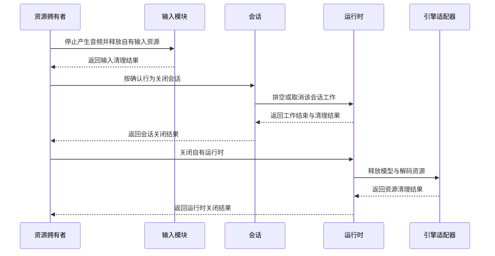

关闭候选队列、实时流、提前最终任务和门控计时器，应纳入同一关闭责任。会话先使旧请求失效，再协调运行时停止任务，最后释放无任务引用的音频与文本状态。

正常排空与立即取消的具体行为由功能规格定义。关闭不能只停止结果展示，却留下仍接收音频的设备或无限运行的后台任务。

服务中的单个连接只关闭其会话和连接资源。服务整体停止时，服务再协调全部会话与共享运行时的关闭。SDK 宿主使用共享运行时时，也应遵守相同的拥有者规则。

### 失败边界

| 失败发生处 | 首要处理者 | 对其余系统的影响 |
| --- | --- | --- |
| 麦克风或文件读取失败 | 输入模块报告，使用入口协调对应会话。 | 不以静音掩盖输入中断，不自行关闭无关会话。 |
| 外部消息或音频格式无效 | 对应接入边界拒绝，核心公开接口保护音频契约。 | 无效输入不进入模型任务；具体会话是否继续由 Spec 定义。 |
| 单个识别任务失败或超时 | 运行时报告执行结果，会话发布有效失败事件。 | 失败归属目标工作，不自动认定所有会话失败。 |
| 模型加载失败 | 运行时停止准备并清理已创建资源。 | 使用入口不能报告模型就绪。 |
| 共享模型或执行资源不可继续使用 | 运行时改变运行状态并报告影响。 | 不能继续假装接收成功；受影响工作如何终结由 Spec 定义。 |
| 客户端断开或输出失败 | 命令行或服务消费入口清理自身资源。 | 不能将结果发送到其他连接，也不能留下无人管理的会话。 |
| 关闭超时或资源清理失败 | 对应资源拥有者报告实际状态。 | 不以逻辑取消代替物理释放完成。 |

失败应保留会话或任务归属。任务失败、会话失效和共享运行时失效是不同范围，不能使用同一个全局失败标记处理所有情况。

## 外部服务与包边界

### 本地推理与模型准备

当前建设范围不接入云端识别服务。模型推理由本地引擎执行，模型下载服务只参与准备。

如果模型需要下载，模型准备入口负责下载和缓存。模型路径、版本和运行参数应可记录，以便复现识别结果。

核心包导入不触发下载、模型加载或麦克风启动。模型已经准备完成时，识别不应依赖再次访问下载服务。

模型来源、版本、文件校验和缓存位置由模型准备入口统一管理。安装器完成下载、校验和原子落盘；引擎只加载确认的模型路径。断点下载与离线缓存复用不能绕过完整性检查。

模型下载与识别准备是不同边界。下载失败不能使运行时报告已就绪；准备完成后的正常推理不应隐含再次下载。

### 安装与加载边界

麦克风、服务框架和具体模型依赖按功能加载。仅接入外部音频的程序不应因缺少麦克风依赖而无法使用核心。

核心公开契约和会话规则不绑定某个具体后端。安装依赖的组合形式由发布设计确定，不能要求所有使用者加载全部可选功能。

核心导入不修改宿主程序的日志配置、环境变量或进程级启动方式。如果运行时使用子进程，应使用自身拥有的进程上下文和资源。

只验证的 Qwen 与 FunASR 使用隔离环境和评估入口。评估入口不是正式适配器；正式包导入、引擎选择、能力查询和发布依赖不能隐含接通候选运行时。

正式运行能力来自安装包。示例程序只能使用正式公开接口，不能通过引用工作区中的临时脚本补齐包内缺失能力。

### 部署与诊断边界

本地 CLI 与 SDK 可不启动网络服务。服务部署持有共享运行时，浏览器可以使用同源静态资源或明确配置的服务地址。

远程监听与 TLS 终止位置由部署配置说明。通过代理时，代理负责外部 TLS，服务负责认证、入口限制与客户端会话绑定；不能因有代理就省略服务容量检查。

日志与指标按会话、音频单元、任务角色和来源关联。输入、分句、排队、模型调用、结果发布和发送分别记录；首结果延迟与结束后最终等待使用不同起点。

Docker 镜像、模型卷和启动命令使用正式安装入口。模型准备可提前完成，进程启动和就绪分别报告。镜像存在不代表 CPU／GPU 或所有模型组合已验证。

## 架构约束与后续设计

### 输入与时间线

两种音频用法使用同一套核心音频规则。重采样、缓冲和帧整理保留跨块状态，实时、候选、最终及修正使用可追溯的音频位置。真实覆盖范围不计入为引擎补零的样本。

语音时长和断句条件依据音频采样进度。任务等待与运行超时使用单调时钟，避免系统时间变化影响超时。

接入协议的消息边界不等于音频单元边界。文件块、SDK 提交块和 WebSocket 消息都不能自行改变已确认的断句语义。

### 状态、任务与结果

会话拥有音频和音频单元状态，运行时拥有模型和执行资源。接入层拥有设备或连接，不直接修改核心内部状态。

后台任务应保留会话、音频单元和代次归属。注册任务后才能接受对应结果，避免立即返回的结果无法关联到任务。

结果发布前应确认任务仍然有效。上一句的最终结果不能覆盖下一句的实时状态，失效代次的结果不能进入新的使用范围。

同轮继续保留音频单元，更新候选边界及恢复代次。会话代次、音频版本与候选代次各自承担有效性判断，不可合并成含义不清的单个标志。

音频单元结束后交出的音频保持固定。共享模型不意味着共享音频缓冲、VAD 状态或解码状态。

### 容量、失败与关闭

系统在接收新工作前检查容量。容量不足时，系统明确拒绝或结束工作，不静默丢弃已接受的最终识别任务。

等待超时、识别失败和取消应形成可判断的终结结果。系统不承诺任意负载下都能持续接收音频。

逻辑失效、结果停止发布和资源物理释放分别处理。关闭结果应说明实际完成范围，不把未退出的模型调用标成已释放。

### 配置与技术选择

配置入口负责合并默认值与调用参数。共享模型配置在加载前确定；会话使用独立配置，不通过修改共享模型配置影响其他会话。

选择模型、运行库和执行方式时，应验证它们能满足上述边界。不能因后端接口方便而让服务直接拥有模型任务，或让所有会话共享可变解码状态。

技术栈已确认的库、运行路线和执行方式是后续设计依据。尚未验证的模型组合、阈值、容量数值及新增进程执行器不构成有效架构约定。形成新结论后，更新技术栈和受影响的模块边界；需要保存详细取舍时，再建立 Decision。

### 后续设计如何沿用架构

下表说明已确认能力及后续设计工作的归属。范围以 PRD 为准，扩展接口不自行增加产品功能。

| 设计工作 | 应沿用的边界 | 应先核对的关系 |
| --- | --- | --- |
| 增加音频来源 | 在输入或接入模块适配，向公开接口提交音频。 | 格式校验、跨块转换、容量反馈和输入关闭，不复制断句与推理流程。 |
| 更换 ASR 后端 | 实现引擎接口，由运行时组装和调度。 | 普通或流式能力、模型并发能力、取消能力、结果转换和资源释放。 |
| 更换 VAD | 在门控与自动分句模块适配，向会话提供边界判断。 | 会话隔离、预录缓冲与音频单元结束责任，不让检测器直接发布最终结果。 |
| 增加独立会话 | 创建独立会话状态与结果消费范围，使用运行时资源。 | 配置、音频、VAD、解码状态和事件均不串会话。 |
| 调整实时识别策略 | 会话组织任务，运行时控制频率，实时文本处理负责稳定与合并。 | 观察来源、音频版本、锚点及快照替换；最终任务不被实时策略丢弃。 |
| 设计两种候选 | 候选与恢复管理记录请求，会话提供固定音频，运行时执行。 | 尾部与整轮范围、失败语义、重试、请求代次和结果来源。 |
| 设计同轮继续 | 会话序列化输入，候选管理更新边界，有序出口提供屏障。 | 保留完整音频，检查旧请求与排队事件，不误称断线恢复。 |
| 设计唤醒和窗口 | 门控与自动分句维护后端及计时状态。 | 唤醒音频归属、正文开口、超时、窗口和重置后失效。 |
| 设计浏览器与远程客户端 | 使用服务协议契约和核心结果含义。 | 音频转换归属、显示来源、停止、清除和断开，不另写识别规则。 |
| 增加接入协议 | 新入口只处理协议与交付，调用同一公开接口。 | 控制请求归属、连接清理、输出缓冲与核心事件含义。 |

设计一个功能时，应先找到负责该功能的模块，再确认输入、输出、状态归属和关闭责任。涉及多个模块的行为，应写清交接，不能只分别列出各模块新增了什么方法。

### Architecture 与 Spec 的衔接

Architecture 确定共享结构和责任。Spec 在这些边界内定义具体功能的行为、错误、字段和验收标准。

| 架构已规定的内容 | 对应 Spec 需要明确的内容 |
| --- | --- |
| 标准音频、连续采样与转换状态按会话保存。 | 支持的输入格式、输入校验、尾部采样、输入结束与无效输入结果。 |
| 会话统一管理自动和手动结束。 | 语音开始与结束条件、结束范围、重复结束、长句边界和取消结果。 |
| 运行时拥有模型、队列和执行资源。 | 准备失败、任务超时、容量拒绝、排空或取消关闭的可观察行为。 |
| 实时稳定与合并按来源和音频单元保存状态。 | 观察序号、稳定证据、中文锚点、失配诊断及显示替换。 |
| 两种候选使用不同快照与失败语义。 | 请求与覆盖字段、重试条件、补零、超时、失效和复用。 |
| 同轮继续保留整轮，更新边界并经有序出口应答。 | 输入确认终点、请求关联、重复操作、事件顺序和旧结果隔离。 |
| 唤醒状态与后续窗口按会话归属。 | 后端配置、激活、超时、正文裁剪和窗口到期行为。 |
| 结果在会话确认有效后按契约交付。 | 事件字段、顺序、实时替换、终结结果和慢消费者行为。 |
| 服务入口负责协议、鉴权和连接，共享运行时。 | 协议版本、音频包、会话绑定、TLS、断开、慢发送和服务状态。 |
| 配置有启动、会话和运行管理生效范围。 | 可修改项、拒绝原因、生效对象和模型重建边界。 |
| 只验证入口与正式包隔离。 | 对照语料、安装环境、测量定义、收益条件和纳入正式范围的依据。 |
| 可选依赖与资源按用途加载。 | 安装方式、缺少依赖的提示、运行入口和关闭验证。 |

Spec 不能通过局部接口改变模块归属。如果功能确实需要改变共享状态、依赖方向或资源拥有者，应先确认结构变化，再同步架构及受影响的功能规格。

具体开发实施计划依据已确认的 Spec 编写，放在 `docs/plans/`。项目规划保留在 ROADMAP，不把本架构文档变成逐项开发任务清单。
