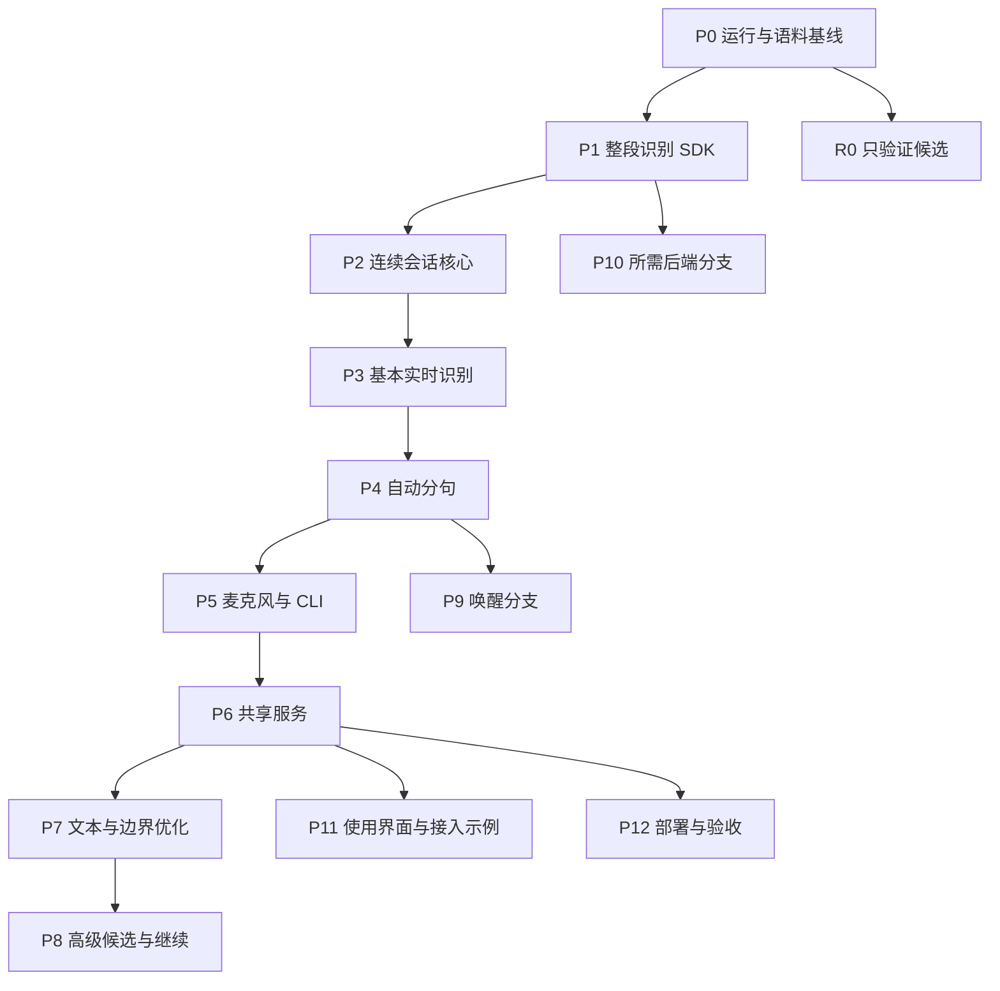

# realtime-asr 项目规划

本文安排已确认能力的建设阶段、前置关系、顺序理由和阶段完成证据。产品范围以 [PRD](PRD.md) 为依据，系统组织以[架构文档](ARCHITECTURE.md)为依据。

本文是项目规划。它不定义具体功能的完整行为，也不安排修改文件、编码任务或执行命令。P0 的具体要求见[运行环境与识别基线 Spec](specs/runtime-and-corpus-baseline.md)；执行安排见 [P0 实施 Plan](plans/p0-runtime-and-corpus-baseline.md)。

具体能力进入设计与开发时，按[文档体系](usage-guide.md)形成对应功能规格。需要拆分执行工作时，再依据已确认规格安排实施；本规划不提前承担这些职责。

## 规划目标

分阶段建设可独立使用、可被其他程序接入的实时 ASR 产品。麦克风和外部音频共用 Python 核心，CLI、SDK、HTTP、WebSocket、远程客户端和浏览器沿用同一套结果语义。

建设范围包含基础识别、连续会话、自动分句、实时文本稳定、双实时模型、两种候选、同轮继续、唤醒和服务运行能力。阶段先后不改变这些能力的正式建设状态。

只验证的 Qwen 与 FunASR 使用独立评估分支，不承诺正式适配。当前不做项不排入后续必做阶段。完整范围及原因只由 [PRD](PRD.md#当前范围)维护。

## 当前起点

项目已接通 P0 的整段、周期快照与原生流式验证入口，并执行真实模型探索矩阵。公开语料标注仍待人工听音；麦克风、SDK、服务和浏览器等后续产品能力尚未实现。

P0 已有运行环境与识别基线 Spec 和对应实施 Plan，其他功能规格及其实施 Plan 尚未建立。文档中的阶段和完成证据是目标安排，不表示相应能力已经实现或验收。

P0 的实际结果、受阻验收和后续启动条件见[开发状态](STATUS.md)。探索矩阵运行完成不表示 P0 正式验收完成。

## 范围如何进入规划

| 范围分类 | 在本规划中的安排 | 阶段结束后形成什么 |
| --- | --- | --- |
| 正式建设 F01—F27 | 每项都有主要建设阶段，并在使用入口或联合验收阶段复核组合行为。 | 实际可用能力和相应验证证据。 |
| 只验证 V01、V02 | 进入 R0 候选评估分支，使用相同语料和测量定义。 | 候选效果、成本、适用环境和是否值得接入的结论。 |
| 当前不做 N01—N12 | 不安排实现阶段，不以“后续扩展”形成默认任务。 | 不要求交付；新需求确认后再调整范围。 |

正式后端按已确认能力选择，不以适配器数量作为阶段目标。已有成熟适配器也不意味着都要实现；只验证项也不因为效果可用就自动转为正式后端。

## 阶段安排总览

### 主线顺序

主线先证明音频与任务正确，再增加实时与自动分句，之后复用核心接入设备和服务。文本及候选优化建立在可测量链路上，避免尚无正确基线就同时增加多种策略。

| 阶段 | 主要结果 | PRD 能力归属 | 主要前置 |
| --- | --- | --- | --- |
| P0 | 运行环境、语料、最终与流式候选基线。 | F07、F26、F27 的选型与评估准备。 | 已确认产品范围与架构边界。 |
| P1 | 可安装的整段识别 SDK 与音频转换。 | F02、F03、F06、F21、F26。 | P0 的可运行普通识别配置。 |
| P2 | 连续会话、任务归属、结束、取消、重置和关闭。 | F04、F06、F24 的核心边界。 | P1 的输入与最终识别链路。 |
| P3 | 周期快照、原生流式和基本实时结果。 | F07，F06 的实时来源。 | P2；所需流式引擎提前接通。 |
| P4 | 双 VAD、前置缓冲与精确录音边界。 | F05。 | P2；与实时结果组合验收需 P3。 |
| P5 | 麦克风、设备、文件／标准输入 CLI。 | F01、F03、F22。 | P2、P4；完整连续体验需 P3。 |
| P6 | HTTP、两种 WS 模式、共享模型及服务运行。 | F21、F23、F24，F25 的最小真实入口。 | P1、P2；自动模式需 P4。 |
| P7 | 稳定文本、声学触发、提前推理、时间戳与句末切分。 | F08—F12。 | 按子阶段分别依赖 P2—P4。 |
| P8 | 双实时、两种候选、同轮继续和候选运行策略。 | F13—F19。 | 按子阶段依赖实时、任务归属和快照。 |
| P9 | 两种唤醒后端、门控、裁剪及后续窗口。 | F20。 | 基础唤醒需 P4；服务窗口需 P6。 |
| P10 | 已确认角色需要的正式后端与模型工具。 | F07、F13—F15、F21、F26 的后端支撑。 | 根据角色依赖提前启动。 |
| P11 | 完整浏览器、客户端、热键和音频保存示例。 | F21、F22、F25、F27。 | 各入口对应核心能力；候选展示需 P8。 |
| P12 | 干净安装、部署、支持矩阵与完整产品验收。 | F26、F27 及全部正式能力。 | 分支验证可提前；完整验收需正式能力完成。 |
| R0 | Qwen 与 FunASR 对照评估。 | V01、V02。 | P0 的语料与测量定义。 |

下面的主线箭头表示推进顺序，分支箭头表示启动条件。编号不表示只能严格串行完成所有大阶段。

P10 不等到 P9 结束才开始。P3 需要的原生流式后端，在进入 P3 前接通；P8 需要的候选或第二实时后端，也提前接通。

P9 的基础唤醒可在 P4 后启动。P11 的热键与保存示例可在 P5 后启动，浏览器基础使用在 P6 验证，高级结果展示随 P8 补全。

安装包从 P1 起持续提供，日志和测量从基线起持续记录。P12 是联合验收，不是第一次安排安装或真实模型验证。

## 主线阶段

### P0：运行环境与语料基线

#### 目的与前置条件

确认目标设备能运行所需识别路径，形成后续配置与验收的依据。前置是产品范围、系统边界和[本阶段 Spec](specs/runtime-and-corpus-baseline.md)已经明确；执行安排见 [P0 实施 Plan](plans/p0-runtime-and-corpus-baseline.md)。

#### 阶段结果

记录 Windows 环境、CPU、GPU、内存、可用运行时与模型准备条件。验证 faster-whisper 普通识别与 Sherpa Nemotron 原生流式的安装及实际输入行为。Kroko 当前暂不做，不进入本阶段。

准备中文为主、英文补充的语料，包含静音、噪声、短句、长句、轻声开口、短暂停顿和快速连续说话。保留样本文本及评估规范化规则。

记录加载时间、实际识别文本、运行耗时和资源使用。周期快照候选检查长句增长成本，原生流式候选检查新增样本输入和结束排空。

形成可采用配置与仍待确认配置的区分。具体版本和设备支持写入选型结论，不能从一个配置推导全部模型组合。

#### 安排理由

音频主链路应使用能在实际设备运行的模型。提前检查流式安装条件，避免到实时阶段才发现依赖或语言覆盖不合适。

效果与性能门槛需要真实基线。本阶段确定测量口径，不凭模型宣传或单次耗时承诺整体体验。

#### 完成证据

- 普通识别候选有真实转写结果，环境与模型配置可复现。
- 原生流式候选的可行性有实际证据，不能仅依据名称判断。
- 语料、文本处理规则和延迟定义已明确。
- 对效果、资源和容量形成可判断的验收口径；不能确定的门槛仍明确列出。
- 所选配置及其限制能够指导后续功能设计，未选配置不宣称已支持。

如果没有可用候选，应先处理选型或环境问题。不能以模型加载成功宣告实时基线完成，也不通过降低音频完整性要求补偿模型不足。

### P1：外部音频与整段识别 SDK

#### 目的与前置条件

建立从外部音频到最终文本的独立可安装链路。需要 P0 已有可运行的普通识别配置。

#### 阶段结果

提供明确格式的字节与数组输入、声道及采样类型转换、有状态重采样、帧整理和尾部刷新。完整文件可解码并送入同一识别链路。

普通识别后端返回统一文本、识别信息和错误。安装包导入不加载模型、下载或启动麦克风；所需依赖按用途准备。

SDK 能执行一次完整识别并关闭自有资源。独立调用示例使用公开接口，日志能定位输入、准备和模型错误。

#### 安排理由

外部音频不依赖设备和网络，能用固定样本重复检查。先验证转换与尾部，后续 VAD、候选边界和时间戳才有可靠的样本基础。

#### 完成证据

- 干净安装后，独立 Python 程序能够完成真实音频转写。
- 同一音频采用不同分块方式，不造成有效样本丢失或重复。
- 不足一帧的尾部被保留，非法格式得到明确错误。
- 引擎缺少某项结果信息时明确为空，不伪造语言概率或时间戳。
- 仅使用外部音频时不需要麦克风依赖，关闭结果说明资源状态。

### P2：连续会话与任务归属

#### 目的与前置条件

使持续输入、已结束工作和下一段音频能同时存在。需要 P1 已验证输入与最终识别。

#### 阶段结果

会话管理活动音频单元、固定任务音频和待交付结果。结束先刷新并确认接受范围，后续音频不改写已提交任务。

开始、结束、取消、重置和关闭具有统一归属。会话代次、任务失效范围、音频版本和输出顺序各自明确，不使用一个全局标记处理所有情况。

建立输入、任务和核心结果的容量边界。采集或输入不等待完整模型推理，慢最终工作不妨碍下一段在容量内接收。

#### 安排理由

实时、候选、多用户和恢复都会增加并发结果。先保证音频与任务归属，才能避免每个新功能独立维护一套状态和取消规则。

#### 完成证据

- 最终识别较慢时，下一段已接受音频仍完整保留。
- 已固定音频不被后续输入改写，结果能定位音频单元。
- 取消或重置后，迟到结果不能覆盖有效新状态。
- 结束、完成和失败有明确含义，不产生重复终结。
- 容量不足被明确报告，关闭不把仍运行任务标为已经释放。

### P3：基本实时识别

#### 目的与前置条件

提供周期快照与原生增量两种实时路径，并与最终识别联合运行。需要 P2，以及已接通的相应后端。

#### 阶段结果

普通引擎周期识别音频快照，过时待执行快照可以合并。原生流式引擎只接收新增样本，结束时完成剩余输入与排空。

运行配置允许最终与实时共用模型，也允许独立模型。结果带识别来源和音频归属，基本实时文本可以被后续观察与最终文本修正。

本阶段不以实时结果代替完整音频最终识别。共享实例并发、实时任务频率和容量受到统一运行时约束。

#### 安排理由

先看清单路实时结果与成本，再增加稳定、声学触发和双模型。周期快照与原生流式是不同输入契约，需要分别证明。

#### 完成证据

- 两种路径都有持续真实音频的实时结果，明确各自后端与环境。
- 原生增量不重复送入完整历史，不丢弃中间样本或句尾。
- 实时工作和最终工作来源清楚，最终文本能修正实时假设。
- 长句与连续输入下，等待和内存增长符合确认容量。
- 模型复用与分离配置不造成会话串音或非线程安全并发调用。

### P4：自动分句与边界保护

#### 目的与前置条件

把连续音频组织为完整录音段。核心边界依赖 P2，与实时结果组合验证需要 P3。

#### 阶段结果

组合双 VAD、句尾静音确认、最短录音和最小间隔。先保留前置缓冲，再验证保守裁剪；增加回溯边界时统一处理左右音频归属。

检测状态按会话隔离，边界判断进入会话。手动模式继续沿用相同封口入口，但不被句内停顿自动结束整轮。

VAD 后端、模型路径与预热分别记录；故障不能被解释成静音。

#### 安排理由

每项裁剪都会改变后续模型输入。先证明有效音频被保留，再减少静音，最后增加精确回溯，便于定位误切来源。

#### 完成证据

- 轻声和正常开口不漏正文首词，短暂停顿不被错误完成。
- 连续说话形成明确录音段，慢最终推理仍不漏下一段。
- 切分位置可定位到标准样本，左右有效音频不丢失或重复。
- 自动和手动模式沿用核心结束语义，检测状态不串会话。
- 每种已配置检测后端有实际运行和故障证据。

### P5：麦克风与命令行独立使用

#### 目的与前置条件

用户无需编写调用程序，就能使用麦克风及已有音频。需要 P2、P4，完整实时体验还需要 P3。

#### 阶段结果

设备查询、选择、采样率处理、采集和释放接入核心。CLI 提供麦克风、文件、文件序列、标准输入及文本／结构化输出。

设备错误、模型就绪和停止状态可见。采集生命周期由输入入口拥有，不把设备句柄放入共享识别状态。

#### 安排理由

固定音频已能复现核心行为后，设备问题可以单独定位。本地完整使用也为服务入口提供结果和退出的对照。

#### 完成证据

- 真实麦克风能连续使用，设备选择生效。
- 不同设备实际格式正确转换到核心，采集不断续。
- 文件和标准输入进入同一处理规则，程序可读取结构化输出。
- 停止与设备失败有明确结果，退出后设备可再次使用。
- 入口从安装包运行，不依赖工作区临时脚本。

### P6：网络接入与共享服务

#### 目的与前置条件

其他程序和浏览器通过服务使用同一核心。HTTP 依赖 P1、P2，持续实时模式依赖 P3，自动分句模式依赖 P4。

本阶段分成接入与运行管理部分，分别检查成果。局部接口可用不表示整项服务能力完成。

#### P6.1：HTTP 与基础状态

完整音频请求进入核心最终识别，返回可判断的结果。存活、模型就绪和能力查询分别描述实际状态。

安排理由是先在单请求边界检查网络输入和核心结果一致性，避免直接从多连接开始定位问题。

完成证据是独立客户端的真实转写、非法格式和容量反馈；模型未准备好时，服务不宣称可识别。

#### P6.2：手动轮次 WebSocket

建立持续音频、开始、结束、取消、重置和有序事件。输入包格式、连续性和样本范围可判断；结束后最终与完成顺序明确。

安排理由是手动结束减少自动端点变量，先证明网络连续输入与最终封口正确。

完成证据是独立客户端持续送音频、结束排空、重复控制和断开清理。传输序号、样本位置和输出序号不能混用。

#### P6.3：自动分句 WebSocket 与最小浏览器入口

服务使用核心自动分句，浏览器真实采集并显示基本实时与最终结果。客户端负责自身麦克风，不由服务访问远程设备。

安排理由是先有协议基线，再验证浏览器采集转换及自动模式。界面暂缺高级展示不能被算作 F25 全部完成。

完成证据是实际浏览器到真实模型的连续识别、正确分句和停止；SDK、CLI、服务对同一模式的含义一致。

#### P6.4：共享模型、调度与容量

多个会话共享模型和公平队列，隔离音频、门控及结果。输入、任务和发送有上限；实时快照、流式增量和终结事件采用不同处理策略。

安排理由是单链路正确之后，才能判断模型共享的排队与多用户影响。输入与输出两端都要受控。

完成证据是多个真实会话不串音，慢客户端和超额输入得到明确处理。最终、完成和控制应答不被实时合并覆盖，阻塞推理不占服务事件循环。

#### P6.5：运行配置、鉴权和部署边界

明确监听范围、Bearer Token、TLS、代理、空闲及结束超时。配置修改区分活动会话、新会话和下次启动；指标分开记录接收、排队、推理和发送。

安排理由是共享资源建立后，才可以确定配置生效和故障影响。远程接入能力不能只交付可连端口。

完成证据是认证及部署组合、配置接受／拒绝、就绪与容量查询、超时和资源释放的实际联调结果。

### P7：文本稳定与结束等待优化

#### 目的与前置条件

改善实时可读性和等待时间，保持已验证音频与最终结果正确性。各子项有独立前置，不要求全部同时开始。

#### P7.1：结构化稳定文本

依赖 P2 的归属和 P3 的观察。提供稳定前缀、待定尾部、稳定增量及最终差异诊断。

先做它，是因为后续标点与候选需要可靠的文本来源。完成证据包括音频推进和观察序号行为、旧代次拒绝及最终不一致诊断；不能强迫最终文本匹配实时前缀。

#### P7.2：声学边界与补识别

依赖 P3 的基本触发与测量。声学检测提供触发信号，会话及运行时管理后续任务。

在已有周期基线下做 A/B，才能看出触发次数、延迟和成本的变化。完成证据包括同一音频的对照结果、长时间任务有界及停用策略后基线行为稳定。

#### P7.3：提前最终推理与动态等待

依赖 P2、P3、P4。静音期间产生带音频版本的最终候选；继续讲话使其不能直接用于当前最终结果。文本策略调整等待仍走统一门控与封口。

先有正确端点再减少等待，避免优化变成误切。完成证据是续说时拒绝旧候选，以及同一语料的最终等待、误切和资源成本对照。

#### P7.4：词时间戳与句末标点切段

依赖可靠时间戳后端、P4 边界和 P7.1 稳定观察。先验证时间范围，再增加已确认的句末模式。

时间信息错误会剪错音频，所以验收应看实际样本归属。完成证据包括左右样本完整、无时间戳时行为明确、数字和短片段不误切，以及长句使用效果。

逗号、破折号、省略号和 all 模式不属于此阶段，也不建立一个默认后续实验切段阶段。

### P8：双实时、候选与同轮继续

#### 目的与前置条件

让调用方在结束前获得不同可信范围的文本，并继续同轮音频。各子项按实际依赖推进，双实时不是两种候选的硬性前置。

#### P8.1：双实时模型合并

依赖 P3，以及可信观察与必要的文本处理。准确实时正文、极速尾部和合并结果保留来源；最终仍由对应音频完成。

单路基线稳定之后再增加第二路，才能判断收益和错误来源。完成证据包括无锚点不拼接、正文变化后尾部重对齐、中文锚点验证，以及首结果和资源变化对照。

#### P8.2a：尾部修复候选

依赖 P2、P3 的快照与实时边界文本。独立尾部推理与对齐输出匹配状态，不以完整最终模型隐式兜底。

先明确来源和失配语义，再判断修复是否有收益。完成证据是有限尾部覆盖、失配状态、不阻塞输入及旧请求不覆盖新状态。

#### P8.2b：整轮候选

依赖 P2 的整轮保留与任务归属，以及所需候选后端。完整快照直接进入候选模型，Live 只作诊断。

它与尾部修复具有不同输入和可信范围，分别建设和验证。完成证据是全轮输入、请求关联、快照版本、失败结果和有界重试。

新音频到来后，旧快照仍可作为注明范围的候选，但不能伪称覆盖当前全部音频。发布有效性和最终复用条件分别检查。

#### P8.3：同轮继续与应答顺序

依赖 P8.2b 的候选归属及 P2 的样本位置和有序出口。记录精确接受边界，保留整轮音频，更新候选／恢复代次并隔离旧结果。

候选来源可靠后才能讨论恢复边界，否则客户端难以判断旧文本对应哪些音频。完成证据包括应答先于新代次结果、旧候选失效、整轮历史保留和继续输入完整。

此阶段不提供跨断线历史恢复，不建立永久录音存储。

#### P8.4：候选运行策略

提示性提前请求依赖 P8.2b；仅候选引擎完成和延后整轮修正依赖整轮快照及最终策略。需要同轮继续组合时，再依赖 P8.3。

常规候选、提示性候选和最终用途的计算成本不同，应在基础路径正确后区分策略。完成证据是显式重试差异、版本一致才复用、追加音频后重新覆盖，以及修正关联原结果。

延后修正有容量与保留期限，不重复终结原轮工作。新增模型角色后重新核对资源与排队基线，但不无依据地重跑全部无关验证。

## 可按依赖提前启动的建设分支

### P9：唤醒词与继续说话窗口

#### 目的与前置条件

使麦克风或外部音频能按唤醒门控开始正文识别。基础门控依赖 P4，实际麦克风使用依赖 P5；服务后续窗口依赖 P6。

#### 阶段结果

Porcupine 和 OpenWakeWord 分别适配到同一门控。验证激活延迟、正文等待、超时、触发音频裁剪，再加入结束后的继续说话窗口。

计时、后端状态和窗口归会话管理，重置或关闭取消旧门控行为。它不创建另一套识别器生命周期。

#### 安排理由

唤醒是录音门控，不依赖双实时或高级候选。因此可在自动分句稳定后提前开始，窗口部分等服务会话就绪。

#### 完成证据

- 两种后端有实际触发、未触发和错误结果。
- 激活、超时与正文开口状态可判断。
- 唤醒词处理不剪掉紧随其后的正文首词。
- 后续窗口内可继续说话，到期恢复正确门控。
- 重置、取消和关闭后，旧计时不能改变新状态。

### P10：按识别角色接通必要后端

#### 目的与前置条件

为正式能力提供实际可用的模型路径，而不是扩充后端数量。前置取决于角色：整段后端供 P1，原生流式供 P3，额外实时或候选后端供 P8。

#### 阶段结果

针对明确角色接通经过验证的后端，声明整段、流式、时间戳、取消、并发和关闭能力。模型文件、缓存、校验、安装与离线条件同步可用。

已有后端能满足角色时复用，不仅因为候选存在就新建适配器。需要原生构建时，构建工具与核心识别包分离。

#### 安排理由

将后端支撑作为可提前启动的分支，能避免主线等到后期才发现模型不可安装。但正式范围仍由具体需求驱动，不能把分支写成全量移植任务。

#### 完成证据

- 每个正式后端都说明承担的产品角色与采用理由。
- 安装、真实转写、结果转换、错误与释放有实际证据。
- 声明原生流式时另有增量和结束排空验证。
- 支持矩阵只列已测平台、设备、模型和版本组合。
- PRD 当前不做后端没有被注册或借“后续支持”混入交付。

Qwen 和 FunASR 不在本阶段默认实现。R0 的结论如支持正式接入，应先确认范围变更，再进入相应后端工作。

### P11：完整使用界面与接入示例

#### 目的与前置条件

让独立用户和开发者能完整使用已建设能力。浏览器基础依赖 P6，候选与恢复展示依赖 P8；热键和保存示例可在 P5 后开始。

#### 阶段结果

浏览器补齐稳定文本、候选来源、最终结果、时间线、音量、复制、清除和停止。Python 远程客户端保留协议归属与运行错误。

CLI 补充服务启动、远程连接和高级结果输出。热键听写、音频保存和独立调用示例沿用公开接口，不构建完整桌面应用。

#### 安排理由

先用最小客户端验证接入，再补完整展示，可以分开定位采集、协议与识别问题。高级能力完成后再显示它们，避免界面自行编造后台不具备的状态。

#### 完成证据

- 真实浏览器和远程客户端完成各自音频到结果流程。
- 可变实时、稳定、候选及最终显示不混淆来源。
- 清除展示、重置后台和停止使用是可区分操作。
- 示例从安装包调用公开接口，不读取核心私有状态。
- 不包含聊天、TTS、翻译产品流程或旧双 WS 兼容承诺。

### P12：部署与完整产品验收

#### 目的与前置条件

证明正式能力可以复现安装、运行和使用。服务部署准备可在 P6 后开始；完整验收需相应正式建设项已完成。

#### 阶段结果

验证干净安装、可选依赖、模型预下载、离线使用、CPU／GPU 配置及服务镜像。镜像就绪、模型卷、网络和停止行为对应正式入口。

按 PRD 成功标准汇总真实使用、效果、容量和资源释放。范围未完成或环境未验证时，记录具体缺口，不以已有局部结果替代。

#### 安排理由

安装和测量贯穿开发，最终阶段检查的是组合产品。只在开发机验证，不能证明其他用户能独立运行。

#### 完成证据

- 确认环境能从干净安装完成本地、SDK、服务和浏览器流程。
- 模型准备后，已声明流程可离线运行。
- 多会话、慢输入／输出、持续长句和退出行为有记录。
- 识别效果、各类等待和资源占用符合已确认门槛。
- 每项正式能力有交付证据；只验证与不做项不计入产品完成度。

## 只验证分支

### R0：Qwen 与 FunASR 中文对照评估

#### 目的与前置条件

判断两种候选是否为中文识别提供值得接入的收益。依赖 P0 的语料、基线与测量定义，不依赖所有主线阶段完成。

#### 评估范围

隔离安装候选运行时，记录具体模型与版本。使用相同音频和文本评估规则比较中文效果、安装条件、加载及推理成本、内存／显存和结果信息。

需要比较实时可行性时，说明使用周期快照还是原生增量，不能据候选名称推导流式能力。评估不接入正式注册、服务能力查询或默认安装依赖。

#### 安排理由

中文是主要评估语言，值得早比较候选收益。隔离验证可以获得选型证据，同时避免未决候选进入正式维护范围。

#### 完成证据与评估出口

| 评估结论 | 后续处理 |
| --- | --- |
| 安装或运行不可用 | 记录环境、失败位置和限制，结束本次评估，不据此声称实现有缺陷。 |
| 能运行，但没有明确收益 | 保留结果，不自动启动适配任务。 |
| 有效果收益，但成本不满足使用条件 | 说明代价和适用环境，仍不进入正式交付。 |
| 有可复现收益，成本与维护条件可接受 | 提出具体角色和支持范围，经确认后更新 PRD、架构及受影响阶段。 |

本分支的成果是评估结论。模型试跑、候选脚本或效果报告都不构成正式 SDK／服务适配完成。

## 待确认事项

以下保留模型、容量和实际使用条件的待验证结论，不重新讨论已确认的产品范围或技术选择。uv、Python 3.12、React／TypeScript／Vite、服务框架、音频库和默认线程运行路线已确认，详见[技术栈](ARCHITECTURE.md#技术栈)。形成实际验证结论时，应更新负责该约定的文档。

| 事项 | 需要明确的结论 | 确认时点 |
| --- | --- | --- |
| 实际硬件与环境 | 补齐 CPU、内存及运行库检查；按已选 uv／Python 环境和 GPU 目录验证真实组合。 | P0。 |
| 最终与实时模型 | faster-whisper 与 sherpa-onnx 的真实运行结果、产品模型规格、语言覆盖与参数。 | P0，并在 P1／P3 接通前落实。 |
| 双实时与候选角色 | 是否复用实例，额外模型的收益、成本与并发限制。 | P8 对应子阶段前；后端支撑提前。 |
| 检测器与采集验证 | 已选 PyAudio、SoXR、WebRTC／Silero ONNX 及两种唤醒后端的安装、状态隔离和预热行为。 | P0 检查本阶段涉及的依赖；P4／P5／P9 前验证对应能力。 |
| 服务协议细节 | 在已选 FastAPI／Uvicorn 上明确协议版本、格式、错误、事件及连接行为。 | P6 功能设计时明确。 |
| 文本与语言处理 | 中文锚点、稳定规则、时间戳及句末判断所需证据。 | P7／P8 对应子阶段前。 |
| 语料与效果门槛 | 中文 CER、英文 WER、规范化、范围和可接受差异。 | P0 定义，效果变化时复核。 |
| 延迟口径与门槛 | 首个实时结果、结束后最终等待、候选等待及推理／发送耗时。 | P0 基础口径，实时、最终及候选能力加入时补充。 |
| 容量与时限 | 输入时长、队列、会话、发送、模型调用、修正保留和关闭时限。 | 基线及对应能力设计时确认。 |
| Qwen／FunASR 收益 | 是否值得正式接入，以及明确的角色和环境。 | R0 形成证据后判断，不预定适配阶段。 |

## 验证与阶段衔接

### 证据分层

| 证据 | 能证明什么 | 不能替代什么 |
| --- | --- | --- |
| 文档检查 | 范围、责任与阶段安排完整且一致。 | 不能证明识别代码存在或实际效果。 |
| 行为验证 | 公开接口的音频连续性、归属、状态、顺序和容量规则。 | 不能仅凭模型替身证明真实模型可用。 |
| 真实模型联调 | 依赖、加载、实际输出、时间信息和模型资源行为。 | 不能代替麦克风采集或浏览器流程。 |
| 真实设备与入口使用 | 设备、格式转换、网络和展示的完整组合。 | 不能由单用户使用推导多会话容量。 |
| 同语料效果与性能评估 | 选定配置下的质量、等待与资源成本。 | 不能推导未测平台、模型或任意负载。 |

后续开发验证遵守[测试规范](standards/testing-standard.md)。从实际公开接口观察已确认行为，边界故障注入不替换核心流程；并发场景用可控时序验证，不靠固定等待猜完成。

### 测量定义

每次评估记录日期、硬件、运行库、模型、参数、语料和测量方法。不同配置分别记录，时间起点保持一致。

| 指标 | 说明 |
| --- | --- |
| 中文字符错误率 CER | 最终文本与标注文本的差异，记录规范化方法。 |
| 英文词错误率 WER | 补充评估英文样本，不替代中文验收。 |
| 首个非空实时结果等待 | 从定义的语音起点到消费方看见首个非空实时结果。 |
| 结束后最终等待 | 从真实语音结束或手动结束的定义起点，到消费方收到最终结果。两种起点分别记录。 |
| 候选等待与收益 | 从候选请求到结果交付，另记录输入覆盖、修复效果与额外成本。 |
| 排队、推理与发送 | 分开判断模型、调度和慢消费者的影响。 |
| 音频与结果完整性 | 已接受样本、切分与快照范围、结果归属及终结顺序。 |
| 内存、显存与任务资源 | 检查持续输入、模型复用、取消和关闭下的增长及释放。 |

最终等待包含端点确认、排队、推理和输出，不能用单次模型推理耗时代替使用延迟。HTTP 整段识别没有实时事件，不据其响应时间推导实时首结果表现。

### 阶段完成与未完成的处理

每个阶段检查自己的主要结果，组合使用再验证跨阶段关系。核心输入或生命周期未完成时，后续入口不能宣称已经补足核心正确性。

一个阶段只完成部分子项时，分别记录已完成和缺口。主线仍可推进不受该缺口影响的独立工作，但不能把大阶段统一标成完成。

新后端、任务角色或状态规则改变时，核对受影响的验证。没有新改动、新失败或未解决疑点时，不重复跑无关全量验证。

## 规划维护

产品范围变化先更新 PRD，结构变化再更新架构，然后调整本规划的能力归属和依赖。不能只在某阶段追加能力，使正式范围和目标结构保持旧约定。

只验证项转为正式建设时，明确收益、角色、支持范围及受影响阶段。当前不做项出现新需求时，也应重新讨论，而不是保留一个永远待做的任务。

本规划不记录每次执行日志。实际结果、验证范围、未完成事项和下一项工作统一维护在 [STATUS](STATUS.md)，不得累积不同任务的完整过程。

P0 的具体规格和实施 Plan 已建立，代码及真实探索验证已执行；正式验收状态由 STATUS 维护。本规划不替代 Spec，也不把能力阶段安排称为开发实施 Plan。
