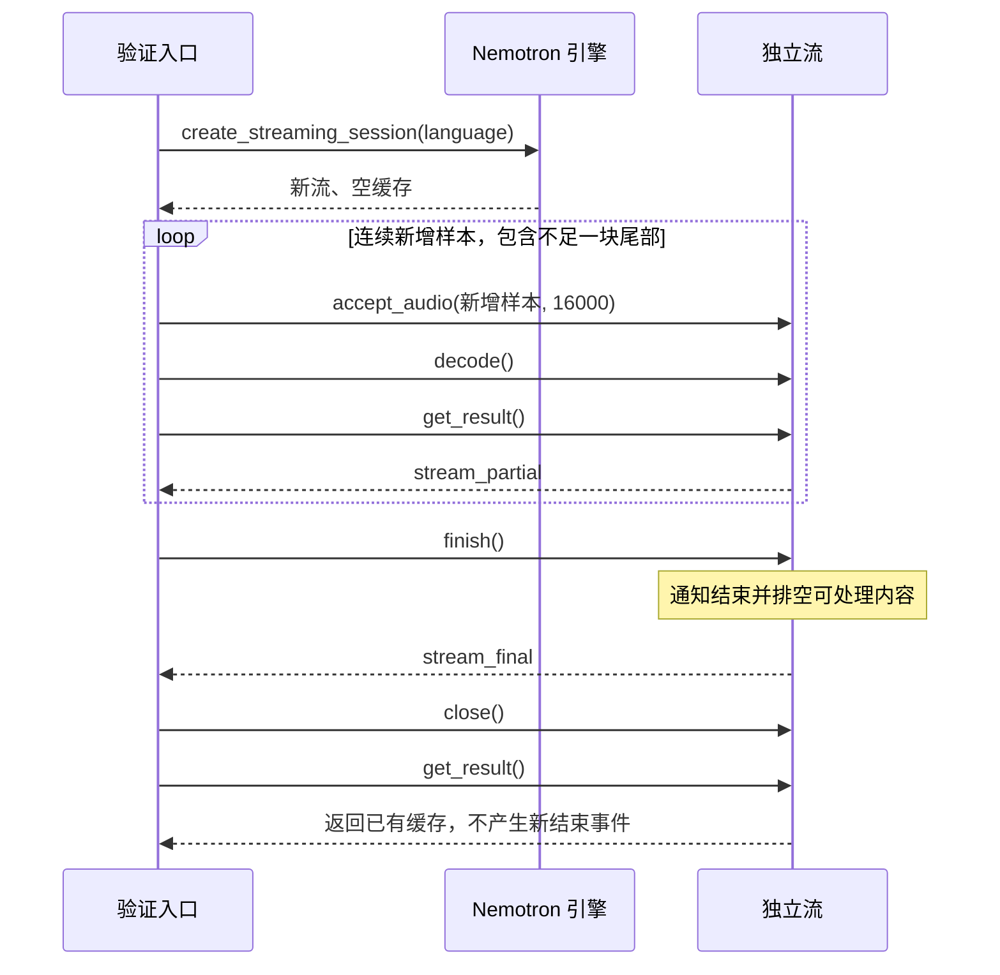

# 功能：运行环境与识别基线验证

本文对应[项目规划 P0](../ROADMAP.md#p0运行环境与语料基线)，规定本机环境检查、模型准备、语料、识别操作、原始记录、评估及完成标准。

产品范围依据 [PRD](../PRD.md#识别后端与验证环境)，接入责任依据[系统架构](../ARCHITECTURE.md#asr-引擎适配器)。本文是本阶段的行为契约。文件拆分、编码任务、测试命令和执行顺序由后续实施 Plan 安排。

## 目标

在 Windows 本机建立可复现的普通识别与原生流式识别基线，为后续输入、会话及实时能力提供依据。

本阶段验证 faster-whisper 和 Sherpa Nemotron。Kroko 当前暂不接入；Qwen ASR 与 FunASR 保留独立评估方向，不进入 P0。

完成本阶段后，应取得以下结果：

- 能定位实际解释器、依赖、模型、设备、语料及运行参数。
- Whisper 完整输入产生真实识别结果，全部分段已经消费。
- Whisper 周期快照产生前缀观察，完整结束结果另行转写。
- Nemotron 按新增样本推进，输出中间文本并在结束时排空。
- 中文字符错误率（CER）、英文词错误率（WER）、等待、推理耗时和资源观测有明确口径。
- 成功、失败、取消、不适用及能力限制分别记录。

本阶段证明规定配置的运行行为和测量结果，不等于产品质量达标或完整 SDK 已交付。没有实测依据时，不预设生产错误率、延迟、显存或并发容量门槛。

## 前置条件

验证对象为项目目标 Windows 本机。执行人员应能读取硬件信息，并在独立的 64 位 Python 环境中准备依赖。

CPU 是必验路径。验证入口应检查 NVIDIA GPU 的实际条件，再决定 GPU 对照的执行状态；具体规则见“配置与验证矩阵”。

执行人员应能取得本地模型、录音及人工核实的标注。模型获取属于明确的准备操作，不属于导入、配置读取或推理的隐含行为。

模型缺失、库不兼容、下载失败和无效音频是运行中应报告的条件。不能以此静默删除必验项，也不能擅自改动系统 Python 或全局运行库。

只有完整配置、语料及评估规则已经固定后，才能开始正式测量。预热和边界故障检查应与正式质量试次分开。

## 用户流程

1. 执行人员声明本次配置和语料清单。
2. 验证入口记录环境及 GPU 条件。
3. 执行人员显式准备或指定本地模型。
4. 验证入口校验模型与语料文件。
5. 验证入口加载指定后端并执行预热。
6. 执行人员按验证矩阵发起各条路径。
7. 验证入口记录原始文本、样本范围及时间点。
8. 评估入口按规定选择结束结果并评分。
9. 验证入口关闭自有流和模型引用。
10. 执行人员汇总结果、限制与未执行项。

每条验证记录应关联配置、样本和试次。某一配置成功，不能覆盖另一配置的失败。开始执行、加载成功和产生非空文本是不同事实。

## 行为

### 配置与验证矩阵

#### 固定配置

| 配置标识 | 后端与模型 | 设备与精度 | 必验性质 |
| --- | --- | --- | --- |
| W-CPU | `faster-whisper==1.2.1`，多语言 `tiny`。 | `device=cpu`，`compute_type=int8`。 | CPU 核心配置。 |
| N-CPU | `sherpa-onnx==1.13.4`，下文固定 Nemotron 3.5 模型包。 | `provider=cpu`，模型包自身为 INT8。 | CPU 核心配置。 |
| W-GPU | 与 W-CPU 完全相同的模型文件和语言参数。 | `device=cuda`，`compute_type=float16`，首个可用设备。 | 条件性对照，不替代 CPU。 |

配置标识是本文的类别名。实际记录的 `config_id` 还应区分语言模式、输入路径、设备及分块条件，不能让参数不同的试次共用一个配置标识。

快照路径的配置包含两个固定参数组：`snapshot_parameters` 与 `final_parameters`。快照和完整结束调用按角色选择参数组；任一组改变后应使用新 `config_id`。

Whisper 固定参数如下：

| 参数 | 值与含义 |
| --- | --- |
| `beam_size` | 整段及独立完整转写为 `5`；周期快照为 `3`，两者分别记录配置。 |
| `batch_size` | `16`，使用批处理推理入口；不表示同时支持 16 个会话。 |
| `vad_filter` | `True`；采用固定运行库的默认 VAD 参数，并记录实际展开值。 |
| `normalize_audio` | `False`，不做逐段峰值归一化。 |
| `initial_prompt` | `None`，不注入领域提示。 |
| `suppress_tokens` | `[-1]`，采用模型默认非语音 token 抑制集合，不添加领域列表。 |
| `use_prompt` | `True`；由于提示为空，不提供额外提示内容。 |
| `word_timestamps` | `False`；本阶段不建立逐词评分标注。 |

未列出的解码参数使用 `faster-whisper==1.2.1` 对应入口的默认值。运行配置应保存实际参数，至少记录影响文本、VAD 和解码的参数；不能依赖日志中只有“默认”二字。

Nemotron 固定参数如下：

| 参数 | 值与含义 |
| --- | --- |
| `sample_rate` | `16000`。 |
| `feature_dim` | `128`。 |
| `num_threads` | `1`。 |
| `decoding_method` | `greedy_search`。 |
| `enable_endpoint_detection` | `False`，由调用方显式结束输入。 |
| `model_type` | 空字符串，让运行库读取模型类型。 |
| `normalize_samples` | 特征配置为 `True`。 |
| `low_freq`／`high_freq` | `20.0`／`-400.0`；单位为 Hz，负值表示相对奈奎斯特频率的偏移。 |
| `dither`／`snip_edges` | `0.0`／`False`。 |
| `normalize_audio` | `False`，不做逐块峰值归一化。 |
| `use_prompt` | `True`，仅保持统一调用参数；此配置不注入提示。 |

其余识别器参数也保持以下基线，不从不同运行库默认值推测：

| 参数 | 固定值 |
| --- | --- |
| `rule1_min_trailing_silence`／`rule2_min_trailing_silence`／`rule3_min_utterance_length` | `2.4`／`1.2`／`20.0`；端点检测关闭，这些值不驱动 P0 分句。 |
| `max_active_paths`／`blank_penalty` | `4`／`0.0`。 |
| `hotwords_file`／`hotwords_score` | 空字符串／`1.5`；不加载热词文件。 |
| `modeling_unit`／`bpe_vocab` | `cjkchar`／空字符串。 |
| `lm`／`lm_scale`／`lm_shallow_fusion` | 空字符串／`0.1`／`True`；不加载额外语言模型。 |
| `temperature_scale`／`reset_encoder` | `2.0`／`False`。 |
| `debug`／`device` | `False`／`0`；使用 CPU provider，不把此索引当作 GPU 支持声明。 |
| `rule_fsts`／`rule_fars` | 均为空字符串。 |
| `hr_dict_dir`／`hr_rule_fsts`／`hr_lexicon` | 均为空字符串。 |
| `lodr_fst`／`lodr_scale` | 空字符串／`0.0`。 |

这些参数应进入 `resolved_parameters`。P0 不加载额外热词、语言模型或规则文件，不允许隐含的嵌套配置覆盖已声明基线。

默认输入块长为 `512` 个样本，即 `32 ms`。默认快照首次请求时刻与后续间隔均为 `0.2 s`。

固定语言配置中，中文和英文分别使用以下提示：

| 后端 | 中文 | 英文 | 自动语言 |
| --- | --- | --- | --- |
| Whisper | `zh` | `en` | 调用参数 `None`。 |
| Nemotron | `zh-CN` | `en-US` | 流语言选项 `auto`。 |

固定语言提示不等于检测结果。自动语言检查单列，不与固定语言配置合并统计。

C08、C09 的固定输入提示沿用中文配置，正文语言仍记为 `none`。T01、T02 采用母样本的中文提示，不因为其文件名或尾块长度改变语言模式。

上述 `tiny` 和 INT8 模型包是 P0 基线，不是产品最终模型组合。配置不兼容时，应报告原配置失败；不能静默换版本、模型、后端或设备。

#### 必验组合

语料类别 C01—C09 及代表样本的选择规则见“语料与标注”。每项矩阵记录都应明确实际样本标识。

| 编号 | 配置与路径 | 样本与模式 | 试次与用途 |
| --- | --- | --- | --- |
| M01 | W-CPU，整段 `transcribe`。 | C01—C09 的全部样本；`offline`，固定语言。 | 每样本 1 次主评分；C01 和 C07 全部样本再重复 1 次。 |
| M02 | W-CPU，周期快照及独立完整转写。 | C01 的首个样本、C02、C04 及尾块变体 T01；`paced`。 | 每样本 1 次；记录快照成本、首结果和完整结束结果。 |
| M03 | N-CPU，新增样本流式。 | C01—C09 的全部样本；`fast`，固定语言，512 样本块。 | 每样本 1 次主评分；C01 和 C07 全部样本再重复 1 次。 |
| M04 | N-CPU，新增样本流式。 | C01 首个、C02、C04、C07 首个、C08、C09 及 T01；`paced`。 | 每样本 1 次；观察中间文本、真实等待及排空。 |
| M05 | N-CPU，分块一致性。 | C01 首个及 C02，另用 160 和 1600 样本块；T01、T02 分别使用 160、512、1600 样本块。 | `fast`；与相同音频的 512 样本结果逐字比较。 |
| M06 | N-CPU，重置与两流隔离。 | C01 首个及 C07 首个；`fast`，512 样本块。 | 顺序重置 1 组、两流交错 1 组，不测并发容量。 |
| M07 | W-CPU 整段及 N-CPU 流式的自动语言检查。 | C01 首个及 C07 首个；`offline`／`fast`。 | 每组合 1 次；单列文本、语言来源及能力限制。 |
| M08 | N-CPU，整段 `transcribe` 包装。 | C01 首个及 C07 首个；`offline`，固定语言。 | 各 1 次，证明一次输入也执行结束与清理；不代替 M03、M04。 |
| M09 | W-GPU，整段识别和快照。 | 整段使用 C01—C09，快照使用 M02 的样本；模式同对应 CPU 路径。 | 整段各 1 次，C01 首个与 C07 首个再重复 1 次；快照各 1 次。 |
| M10 | 本地操作与故障边界。 | API 表、状态表及 F01—F12。 | 验证明确失败及重复调用；不纳入识别质量。 |

“首个样本”指语料清单中预先声明的 `representative_sample_id`。它应属于对应类别，并在观察识别结果前固定。不能根据识别效果临时更换代表样本。

M01、M03 的首次正式试次属于 `primary`。重复试次属于 `repeat`。M02、M04—M08 及 M10 属于 `diagnostic`，不得重复计入 CPU 主评分。

M09 有独立 GPU 主评分，不能加入 W-CPU 的汇总。M07 的自动模式不得混入固定语言的主评分。

#### 预热与重复

每次新加载配置，应先用 C01 的代表音频预热 1 次。Whisper 使用整段调用；Nemotron 使用新流接收音频、结束并关闭。预热失败时，不能直接进入该配置的正式试次。

预热记录的 `evaluation_role` 为 `warmup`，不计质量和正式耗时。正式试次从 `trial_index=1` 开始，重复试次为 `2`；不能用一次预热冒充首次正式测量。

同一配置的正式试次复用已加载模型，每个流式试次创建新流。另对 W-CPU 和 N-CPU 各执行一次关闭引用、重新加载及代表样本识别，验证重新初始化。

两流隔离检查只交错调用，不同时调用同一 Nemotron 识别器。模型访问串行化，不据此宣称线程安全或并发容量。

#### GPU 条件与阶段结论

发现 NVIDIA GPU 后，应记录型号、驱动及推理依赖，并尝试初始化 W-GPU。依赖缺失可在调用前报告，不能改用 CPU 并保留 GPU 配置名。

没有 NVIDIA GPU，M09 记为 `not_applicable`。设备存在但运行库缺失，记为 `blocked`；模型初始化或推理发生错误，记为 `failed`。这些状态不能写成“GPU 验证通过”。

P0 的阶段结论使用以下规则：

| 结论 | 条件 |
| --- | --- |
| `passed` | 两种 CPU 核心路径、必需边界、语料及记录均通过；适用的 GPU 对照完成，没有需要标为受限的未通过检查或采集缺项。 |
| `passed_with_limit` | CPU 核心行为与必需记录通过；GPU 对照失败或受阻，或自动语言／资源信息存在已明确的能力限制。 |
| `blocked` | 任一 CPU 核心配置无法运行，必需输入／结束／隔离行为不满足，或必需证据不完整。 |
| `cancelled` | 当前验证被取消，剩余必验组合没有完成。 |

M07 应实际检查。自动模式运行失败或无法报告检测语言时，应保留原因；它不替代固定语言核心条件，也不自动增加其他模型。

后端本就不提供校准语言概率，不属于本阶段意外限制。没有 GPU 时的显存字段不适用，也不因此将 CPU 结论标为受限。

有 GPU 但对照失败，仍可在 CPU 核心行为全部满足时形成 `passed_with_limit`。后续仅可采用已经验证的 CPU 配置，不能据此声明 GPU 已支持。

### 环境与模型准备

#### 环境检查

环境记录应包含操作系统版本、构建号、CPU、逻辑处理器数、总内存、Python 版本、位数及解释器绝对路径。

依赖记录包含实际 `faster-whisper`、CTranslate2、`sherpa-onnx` 和 NumPy 版本。CUDA、cuDNN 和 GPU 驱动信息应区分实际推理所用版本与系统安装信息。

某字段不可读取时，应记录 `null` 及原因。缺少实际解释器或核心依赖信息时，不能声称配置可复现。GPU 专用依赖缺失不应阻止另一 CPU 后端单独检查。

#### 模型准备输入与结果

准备操作接收后端、模型标识、目标目录及来源，返回模型记录和逐文件校验结果。目标目录应明确指定；不得因导入模块而创建缓存或下载文件。

Whisper 使用固定版本运行库对多语言 `tiny` 的模型来源映射，取得 CTranslate2 模型目录。准备时应解析并记录实际仓库与不可变修订，不仅记录 `tiny` 或 `main`。

Whisper 清单至少包含 `model.bin`、`config.json` 和 `tokenizer.json`。该修订提供预处理配置或词表文件时，也应保留；没有预处理文件时记录该版本实际采用的默认特征参数。

准备成功时应保存实际推理所需文件的完整清单、大小和 SHA-256。不允许推理时从其他修订补取缺失的 tokenizer 或配置。

首次显式准备固定模型修订和清单。后续离线运行应复用同一清单，并重新校验；不能为消除校验失败而用当前文件覆盖旧清单。改变修订或转换方式时，应建立新模型记录。

Nemotron 固定模型标识为：

`sherpa-onnx-nemotron-3.5-asr-streaming-0.6b-560ms-int8-2026-06-11`

固定压缩包来源为 [Sherpa ONNX 模型发布](https://github.com/k2-fsa/sherpa-onnx/releases/download/asr-models/sherpa-onnx-nemotron-3.5-asr-streaming-0.6b-560ms-int8-2026-06-11.tar.bz2)。压缩包大小为 `475271763` bytes，预期 SHA-256 为：

`c6bf5e0df765f9d5b43bc9e0536d4b4b3e7d40bdf5ecf13e45f134c51c05ae3a`

| 必需文件 | 预期大小（bytes） | 预期 SHA-256 |
| --- | --- | --- |
| `encoder.int8.onnx` | 657601403 | `012e9321373af99021415e0b0eb3ec827b4be3153be6f30d9b448fe65e896e68` |
| `decoder.int8.onnx` | 14978075 | `19f9c98fc6d0a2c33a65a43b36fdb2e914c26c0aa9764be3aebc502a1e982fb0` |
| `joiner.int8.onnx` | 9504438 | `4101c7c679a0bc30483794b27a059e34e79232aa2068d78d51231a22c8b0d7ce` |
| `tokens.txt` | 131440 | `729cc103155bafa785f9cd45746cd41cabe97eab7182fc04d594129587958f8a` |

这些是准备时的校验约束，不是本项目已下载或实测的声明。缺失、大小不符或哈希不符，应报告实际文件问题，并在模型加载前失败。

#### 离线与重复准备

模型已经准备且校验通过时，识别操作只使用本地目录，不通过模型简称补下载。

同一目标目录已经有正确文件时，重复准备应复用文件并重新核对，不重复下载。目录中只有部分文件时，应报告不完整；只有显式准备操作才可补齐。

离线准备面对不完整模型时，应失败并保留原文件。不应在推理失败后偷偷下载、替换模型或重建清单。

本地模型加载和识别均应在禁用模型获取网络的条件下完成一次。准备操作的联网成功不能代替此项。

### 语料与标注

#### 语料覆盖条件

基线语音来自现成录音或外部取得的录音，本阶段不实现麦克风模块。中文为主，英文用于语言和接入对照。

以下数量、时长和增广参数是 P0 的验证条件，不是模型性能门槛，也不是已测结果。清单至少包含 12 个不同样本标识，另有 2 个尾块变体。

SNR 表示语音与噪声的能量比例，以 dB 表示。RMS 表示样本的均方根幅度。增广记录应使用这些定义，不用峰值比例代替能量比例。

| 类别 | 最低覆盖 | 可复核条件 |
| --- | --- | --- |
| C01 清晰中文短句 | 3 个样本。 | 各 1—10 s；完整正文；人工能听清首尾词；至少来自 2 位说话人。 |
| C02 中文长句 | 1 个样本。 | 不短于 30 s；有效语音累计不短于 20 s；至少 3 个句子及 60 个规范化字符。 |
| C03 轻声开口 | 1 个样本。 | 从 C01 代表音频生成；从首次语音起点开始的 0.5 s 区间幅度乘 0.1，其余语音不变。 |
| C04 句内短暂停顿 | 1 个样本。 | 两段可听清的中文语音之间插入 300 ms 静音；正文连续且标注两段边界。 |
| C05 快速连续说话 | 1 个样本。 | C01 代表音频离线按 1.25 倍速度压缩时长；正文人工复核不变。 |
| C06 带噪中文 | 1 个样本。 | C01 代表音频与已记录噪声混合，目标 SNR 为 10 dB；记录噪声及混合参数。 |
| C07 清晰英文 | 2 个样本。 | 各 1—15 s；完整英文正文；人工核实音频与标注一致。 |
| C08 纯静音 | 1 个样本。 | 3 s，全部 PCM 样本为零，正文为空。 |
| C09 非语音噪声 | 1 个样本。 | 3 s，无可辨识人声，至少存在一个非零样本，正文为空。 |

C03、C04、C05、C06 可基于已有录音构造，但应有新样本标识、文件哈希及准备记录。不能把增广样本当作额外说话人。

C03 的区间从人工标注的首次语音起点开始，长度不超过 8000 个样本。该区间应确实包含语音；转换后应重新听音确认。

C04 两侧各保留不少于 1 s 有效语音。插入静音为 4800 个样本。合成后记录新的语音区间及正文，不以模型输出决定正文。

C05 应记录时间压缩方法和实际输出样本数。变速后的边界重新标注，不能把原音频的样本位置直接复用。

C06 在有效语音区间计算原语音 RMS，并在同一区间计算噪声 RMS。按 10 dB 的目标比例缩放噪声后混合；噪声 RMS 为零时准备失败。

噪声缩放系数为 `speech_rms / (noise_rms * 10^(snr_db/20))`。噪声截取长度应等于母样本长度；素材不足时准备失败，不隐含循环或填静音。

混合结果需要避免 PCM16 削波。若整体等比例缩小，应记录缩放系数；不能只截断峰值后仍声称保持原混合条件。随机混合或噪声截取应记录种子及起止位置。

#### 尾块变体

T01、T02 基于 C01 代表音频生成，总样本数除以 512 的余数分别为 1 和 511。

准备时可调整首尾静音，但不能删除语音正文。至少一个变体的最后不足一块区间应包含标注语音中的非零样本，避免只用静音证明尾块保留。

每个变体保存新的文件哈希、总样本数、正文及语音区间。普通转写和增量输入均读取变体的完整内容，不从母样本复用识别输出。

#### 音频格式与有效范围

标准文件为未压缩 WAV，采样率 `16000`、单声道、16 位有符号 PCM。PCM 字节按小端解码。

解码后得到连续的一维 `float32` 数组，形状为 `(sample_count,)`。每个 PCM16 数值除以 `32768.0`；值域为 `[-1.0, 32767/32768]`。

语料 WAV 的 `sample_count` 应大于零。多声道、其他采样率、其他采样宽度、压缩 WAV、截断帧及损坏文件应在模型调用前失败。

原始素材的格式转换在语料准备中显式完成。保存原文件来源和哈希、转换方法、参数及输出哈希；本阶段不实现任意格式接入或跨块重采样 SDK。

流操作的空数组与空语料文件不同。合法开放流接收零长度块时不改变累计范围；该行为不允许将空 WAV 纳入正式语料。

#### 标注与版本

每个样本保存原始正文、语言、类别、来源及一个或多个语音区间。语音区间使用半开区间 `[start_sample, end_sample)`，并按起点排序、互不重叠。

有效语音样本至少有一个区间；C08、C09 的区间列表为空。区间端点应位于 `0` 到 `sample_count` 之间，且起点小于终点。

正文及边界由人工听音核实。标注起止只用于评估，不作为模型解码输入，不生成模型应返回的文本。

语料清单保存 `corpus_version` 和代表样本选择。音频、正文、边界或准备参数改变后，应形成新版本；不能沿用旧哈希和旧评分。

### 普通整段识别

调用方通过 `transcribe` 提交完整标准音频。输入格式、语言、提示参数及结果字段应遵守 API 和数据章节。

调用方应消费 Whisper 返回的全部分段。结果文本使用分段文本按顺序以一个空格连接，再移除整体首尾空白；保留原始分段文本用于追溯。

完成时点是分段消费和结果转换完成的时点，不能停在返回迭代器或取得首段时。

Nemotron 整段包装应创建独立流，接受完整音频，再 `finish`，最后 `close`。它证明包装行为，不替代真实新增样本验证。

合法语音返回空文本时，调用属于成功，质量评分按删除错误计算。加载、格式或推理异常属于失败，不返回预设空白成功。

静音和噪声的非空输出记录为非语音误转写，不直接改写为异常。每个 CPU 后端至少一个 C01 及一个 C07 样本应有非空结束文本，才满足基本识别条件。

### 周期快照识别

#### 请求范围

快照路径只使用 W-CPU 或 W-GPU 的普通引擎。每次输入为 `audio[0:end_sample]` 的固定副本，不向普通引擎递交仅新增的尾部块。

音频使用绝对回放时钟推进。首次请求位于 `3200` 个样本，后续每增加 `3200` 个样本形成一个请求机会。覆盖终点不超过当前已经可用的样本数。

距试次原点 `elapsed_ns` 时，可用样本数为 `min(sample_count, floor(elapsed_ns * 16000 / 1000000000))`。快照在实际启动时读取该终点，结果固定关联启动时的前缀。

某次机会被替换后，应保留它的请求终点和替换原因。最新机会实际启动时可覆盖更多已经可用的样本，不假装过时机会已经全部执行。

模型忙时，只保留一个尚未启动的最新快照机会。新机会覆盖旧机会时，应记录旧机会的终点及 `superseded` 原因，不保留无限排队的旧前缀。

已经开始的快照使用启动时确定的前缀，不因后续音频到达而修改数组。每次结果关联独立 `snapshot_id` 及实际覆盖终点。

#### 输入结束与结果用途

输入结束后，停止生成新快照。尚未启动的快照机会标为 `discarded_at_end`，不再执行。

输入结束与快照机会处于同一时刻时，先结束，不启动该机会。实际停止时刻按计划文件结束记录，不等模型忙完后才宣布音频结束。

已经在途的快照允许完成，结果仍为 `snapshot_partial`。它可以进入原始观察，但不能改名为完整结果，也不能代替结束后转写。

在途调用结束后，再提交完整音频执行一次独立转写，输出 `snapshot_final`。同一引擎实例不同时执行快照和完整转写。

快照调用使用 `beam_size=3`，独立完整转写使用 `beam_size=5`。两种调用保留各自的实际参数记录，不能把快照参数标成完整识别参数。

即使最后一次快照恰好覆盖全部样本，也应保留独立完整转写。完整转写使用固定模型和语言配置，不换更大模型。

音频短于 0.2 s 时，不生成中间快照，只执行完整转写。没有中间文本时，首中间结果指标为 `null`，不能写为零。

快照只用于观察前缀、修改次数和成本。P0 不对 `snapshot_partial` 计算 CER／WER，不用完整正文评分尚未送入的语音。

### 原生流式识别

#### 输入与解码

Nemotron 创建独立流，并在第一块输入前设置流语言。固定语言和 `auto` 都通过该流自身的语言选项声明，不能改变共享识别器的全局语言。

每块仅包含尚未提交的新样本。正常块的半开区间连续，累计终点等于本次实际已接受的样本数。

接受一块后，应持续解码，直到识别器不再报告该流可处理。随后读取当前文本，形成 `stream_partial` 观察。

记录的范围表示已接受样本，不表示模型已经对全部范围完成解码。运行库未提供解码音频终点时，该字段为 `null`，不能用输入终点冒充。

中间结果可为空，也可改写前文。相同文本重复出现不证明稳定前缀。P0 不把中间文本升级为产品稳定、最终或分句事件。

#### 结束与缓存

全部样本已经实际提交后，调用 `finish` 通知原生流输入结束，再排空可处理内容。成功结果属于 `stream_final`。

结束通知不可调用时，应报告配置失败；不能用最后一条中间文本代替结束结果。最后不足一块的样本应先提交，不能为凑整块补掉、丢弃或重复语音。

重复 `finish` 不再发送结束通知。它可再次确认没有可解码内容，并返回相同缓存结果。不能把重复结束当作另一次正式识别试次。

关闭前已经得到结束结果时，关闭后读取缓存仍保留正文。关闭前只得到中间结果时，关闭后缓存仍是中间结果，不能因缓存可读而生成结束成功。

没有接收样本的流允许调用 `finish`，应记录原生实际结果及零样本范围。它是 API 边界检查，不是合法空语料或主质量试次。

#### 重置与隔离

开放或已结束的流允许 `reset`。重置先释放旧原生流，再建立新流并设置原语言；缓存清空，输入位置从零开始，观察序号重新开始。

重置应产生新的 `stream_id`，旧记录仍保留。不能把新正文写进旧流标识，也不能在失败后复用旧缓存冒充新结果。

M06 的顺序检查先对 C01 代表样本完成一次识别，再重置并输入 C07 代表样本。第二轮应与该英文样本的独立识别结果一致，不带中文缓存。

两流交错检查创建两个独立流，依次轮流递交各自新块，较短音频可先结束。最终结果分别与各自独立运行结果一致，不根据完成先后绑定样本。

M05 对完全相同的音频检查 160、512、1600 样本分块。中间结果出现时点可不同，最终 `text` 应逐字一致。若不一致，应记录差异并使该项验收失败，不能改用规范化掩盖差异。

### 失败、取消与资源

#### 失败分类

失败记录同时包含稳定的原因分类、发生操作、异常类型及实际消息。稳定分类用于判断结果，不要求固定第三方错误全文。

输入在递交前校验失败时，累计接受范围保持不变，原生流仍可继续接受合法块。原生接受、解码或结束操作发生异常时，当前试次失败，不再追加音频。

原生异常可能发生在内部状态改变后。验证入口只记录最后已确认的范围，并将失败调用的范围另存为 `unconfirmed_range`；不能猜测它已全部接受或全部未接受。

原生试次失败后，只允许保留诊断缓存并关闭资源。后续新试次创建新流，不能通过同一失败试次的重置继续评分。

#### 取消

取消请求应记录 `cancel_requested_ns`，停止新输入、新快照和完整结束转写。

尚未开始的工作直接取消。模型调用已经开始且后端不能立即中断时，应等待调用返回，再清理自有资源，不承诺取消请求会立即停止原生计算。

取消后返回的文本可保留为 `late_result` 诊断，但不得生成成功结束结果、加入评分或替代取消结论。原先已经形成的观察不删除。

取消流不调用 `finish` 来补出“正常结束”。关闭未完成流后，缓存可能仍可读，其来源应保持为中间诊断。

取消请求时间、在途返回时间和资源关闭时间分别记录。不能把请求被接受写成资源已经释放。

#### 关闭与释放

`close` 可重复执行，不再向流提交音频。开放流关闭不隐含结束排空；正常试次应先 `finish` 再 `close`。

运行库提供流 `close` 或 `release` 时，应调用可用释放入口；没有显式入口时，移除自有原生流引用。记录实际采用的方式，不能把引用清除写成显存已回收。

清理错误应可观察，不能覆盖原推理错误。重复关闭不恢复输入，也不把首次清理失败改为成功。

模型没有显式释放接口时，记录引用释放，并在退出验证进程后检查自有子进程和资源残留。不得据此宣称长期宿主中的模型回收已经验证。

### 测量、评分与汇总

#### 时钟与输入模式

每个正式试次使用独立单调时钟原点 `t0`。记录时间字段统一为距该原点的整数纳秒，不能用系统日期计算耗时。

`t0` 在模型已经就绪、标准音频已经读入内存、准备开始输入时取得。加载、文件读取和预热耗时独立记录，不加入该试次推理耗时。

| 模式 | 约束 |
| --- | --- |
| `offline` | 完整数组一次提交，不模拟麦克风时间，不产生首中间结果等待。 |
| `fast` | 新块按顺序尽快接受和解码，不人为等待；用于解码成本及主流式评分。 |
| `paced` | 按绝对音频时钟使样本可用；计算等待，不能因解码慢而移动时钟原点。 |

`paced` 中，样本位置 `s` 的时刻为 `s / 16000` 秒。块 `[a,b)` 在 `b / 16000` 秒全部可用，不能提前递交未到达的样本。

执行已经落后时，后续块可顺序追赶，不额外等待，也不丢弃原生增量。每块记录计划可用、实际开始接受及接受完成时刻，区分输入延迟与解码耗时。

流的结束通知在最后一块实际接受并解码后发送。音频文件结束的计划时刻与实际结束通知时刻分别记录，不能把积压时间藏入时钟重置。

快照按请求机会取已经可用的最新完整前缀。在途推理不停止回放时钟；这不要求公开特定线程、任务队列或产品调度器。

#### 时间点与公式

下表字段均以纳秒记录；结果报告可除以 `1000000` 显示毫秒。

| 时间点 | 定义 |
| --- | --- |
| `speech_start_ns` | 最早标注语音起点乘 `1000000000 / 16000`，按整数纳秒四舍五入。 |
| `speech_end_ns` | 最后标注语音终点按相同规则转换。 |
| `input_end_due_ns` | `sample_count / 16000` 对应的计划文件结束时刻。 |
| `first_nonempty_partial_ns` | 验证入口首次取得非空中间结果的时刻，含文本转换完成。 |
| `finish_called_ns` | 原生结束通知操作开始；快照路径为停止生成快照的时刻。 |
| `final_received_ns` | 成功结束结果已经完整取得的时刻。 |
| `call_started_ns`／`call_completed_ns` | 每次实际推理操作的开始与结果转换完成时刻。 |
| `close_completed_ns` | 自有流关闭操作完成，不表示模型显存已经回收。 |

语音样本的等待指标只在 `paced` 模式计算。C08、C09 没有语音起止，`speech_start_ns`、`speech_end_ns` 及语音等待均为 `null`。即使模型误输出文本，也不能伪造语音边界。

| 指标 | 公式与适用条件 |
| --- | --- |
| `first_partial_wait_ms` | `(first_nonempty_partial_ns - speech_start_ns) / 1000000`；仅 M02、M04 及 GPU 快照。 |
| `speech_to_final_wait_ms` | `(final_received_ns - speech_end_ns) / 1000000`；仅有语音的 `paced` 试次。 |
| `drain_ms` | `(final_received_ns - finish_called_ns) / 1000000`；只用于原生流式结束。 |
| `snapshot_end_to_final_ms` | 快照停止到独立完整转写完成；包含等待在途快照及完整调用，不叫原生排空耗时。 |
| `inference_ms` | 完整 `transcribe` 的 `call_completed_ns - call_started_ns`，包含全部分段消费。 |
| `accept_lag_ms` | 本块实际接受开始减去计划可用时刻，用于 `paced` 输入。 |
| `call_ms` | 每次快照、接受、解码及结果读取的实际调用耗时；按操作分别记录。 |
| `rtf` | `offline` 完整调用耗时，或 `fast` 的接受、解码、读取及结束调用耗时之和，除以音频时长。 |
| `snapshot_rtf` | 每次快照调用耗时除以其前缀时长；与整段／流式 RTF 分列。 |

RTF 的分子不包括文件读取、加载、预热、记录写盘、人工回放等待及资源关闭。原生结束中的解码不得在分子重复计算；重复 `finish` 的边界检查不纳入正式 RTF。

没有非空中间结果时，首结果时间与等待为 `null`，原因记为 `no_nonempty_partial`。`offline`／`fast` 的等待指标为 `null`，原因记为 `not_paced`。

首次非空中间结果早于标注语音起点时，保留负值并标记 `pre_speech_output`，另记非语音误输出。不把负值截成零，也不计入正常首结果等待汇总。

加载记录使用另一个明确的单调计时间隔。下载、校验、加载和预热各有自己的开始、结束及结果，不能合成“启动耗时”后失去边界。

#### 资源观测

对自有推理进程采样，间隔为 100 ms。记录进程标识、RSS、采样起止及观察到的峰值；首次或最后一次不足间隔的采样也保留。

RSS 是进程当前驻留物理内存的字节数。没有运行的 GPU 路径不采集显存，不将它记为零字节的成功 GPU 观测。

GPU 运行时，能够取得该进程显存信息则按相同间隔记录。驱动只给设备总占用时，应标为 `device_total`，不能写成推理进程的独占显存。

字段不可取得时使用 `null` 和原因。短于采样间隔的调用可能遗漏真实峰值，报告应称“采样观察峰值”，不能称绝对最大需求。

记录加载后、预热后和关闭后观测。资源不回到原数值本身不直接证明泄漏，显式释放成功也不直接证明长期回收。

#### 评分对象与规范化

主评分只采用 M01 的整段结束文本及 M03 的流式结束文本，每个样本使用第 1 次正式试次。它们分别形成 Whisper 与 Nemotron 的固定语言基线。

M02、M04、M07、M08 及 M09 的结束结果可独立评分，但应保留路径、语言模式和设备分组。不将它们重复加入 M01、M03 的总分。

`snapshot_partial`、`stream_partial` 和 `late_result` 不计算 CER／WER。中间结果仅记录非空出现、文本变化及与结束结果的差异，不要求本阶段逐词对齐标注。

中文规范化按以下固定顺序执行：

1. 将正文和模型文本转换为 Unicode NFKC。
2. 将拉丁字母转为小写。
3. 删除 Unicode 空白字符。
4. 删除 Unicode 类别以 `P` 开头的标点字符。
5. 按 Unicode 码点形成字符序列。

保留汉字、数字、字母和非标点符号。不转换同音词、简繁体、数字读法或数字与汉字写法。

英文也先执行 NFKC 和小写，再将 `P` 类标点替换为空格。合并 Unicode 空白，移除首尾空白，按空白分词。撇号按同一标点规则处理，不另设后端特例。

规范化规则标识为 `p0-text-v1`。原始正文、原始文本及规范化文本全部保留。不能根据模型错误修改规则后只重算某个后端。

#### 错误率与重复试次

CER／WER 使用单位代价的 Levenshtein 编辑距离：`E / N`。中文 `N` 为规范化正文字符数，英文 `N` 为规范化正文词数，`E=S+D+I`。

若记录 S、D、I 的明细，同代价路径按匹配、替换、删除、插入的顺序择优。总编辑距离不因同代价路径选择而改变。

合法语音的空假设按 `D=N` 计算。空标注不计算错误率；静音与噪声按成功试次中非空输出数除以该类成功试次数统计。

示例仅说明评分规则：正文“你好世界”、结束文本“你好”，中文 `N=4`、`D=2`、`CER=0.5`。同一“你好”若属于未结束的前缀，只记录观察，不用完整正文计算 CER。

每个配置、路径、语言模式、语料版本和试次角色单独汇总。主汇总累加 `E` 和 `N` 后相除，不直接平均样本百分比，也不把中文与英文合成一个错误率。

重复试次单独报告文本是否一致、各次评分及耗时。不得用错误率最低的重复文本替代主试次，也不得把多个重复混成一个更大的主语料集。

失败、取消及未执行试次不伪造评分或成功耗时。汇总应同时给出应执行数、成功数、失败数、取消数和缺失数，不能只显示成功样本的低错误率。

每个必验组合只执行矩阵规定的试次。报告可列单次值、均值、中位数和观察最大值；本阶段不发布 P95、长期稳定性或多会话容量结论。

## 数据

本阶段读取环境、模型文件、音频及标注，生成验证记录。机器可读记录使用 UTF-8 JSON 对象或 JSON Lines；最终保存位置由实施 Plan 安排。

字段名是本阶段验证记录的契约，不是完整产品 SDK 的类型或包路径。调用返回可用对象或字典表达，但保存后的字段含义应一致。

所有顶层记录都有 `schema_version`、`record_type` 和 `run_id`。环境、模型、配置和语料记录另有各自标识，不要求填入尚不存在的试次或流标识。

观察、试次、资源及边界检查记录应包含 `config_id`、`sample_id` 和 `trial_id`。只有没有具体样本的环境／模型阶段资源记录，才允许 `sample_id` 和 `trial_id` 为 `null`。

### 通用字段与标识

| 字段／规则 | 类型 | 约束 |
| --- | --- | --- |
| `schema_version` | 整数。 | 固定为 `1`。 |
| `run_id` | 非空字符串。 | 同一次环境、配置及语料验证的归属标识。 |
| `config_id` | 非空字符串。 | 参数或设备改变后使用新标识。 |
| `sample_id` | 非空字符串。 | 稳定定位一份音频及其标注。 |
| `trial_id` | 非空字符串。 | 每次正式、预热或故障检查分别唯一。 |
| `stream_id`／`snapshot_id` | 字符串或 `null`。 | 适用路径必填；重置使用新流标识。 |
| 时间 | 整数纳秒。 | 同一试次共用原点；不可取得时为 `null`，并附原因。 |
| 缺失值 | `null`。 | 不用空字符串、零或“未知”替代未知数值。 |

标识的内部生成格式不作要求，但在一个 `run_id` 内不能冲突。记录使用相对路径时，应保存明确的基准目录；解释器和实际模型目录另保存绝对路径。

### 环境记录

| 字段 | 类型 | 含义与约束 |
| --- | --- | --- |
| `record_type` | 字符串。 | `environment`。 |
| `environment_id` | 非空字符串。 | 本次实际环境记录的标识，供配置引用。 |
| `recorded_at` | ISO 8601 字符串。 | 带时区的记录日期时间，不用于耗时。 |
| `os_version`／`os_build` | 字符串。 | 实际 Windows 版本与构建号。 |
| `python_version`／`python_path` | 字符串。 | 实际解释器版本及绝对路径。 |
| `python_bits` | 整数。 | 本阶段为 `64`。 |
| `cpu_name` | 字符串或 `null`。 | 实际 CPU 名称。 |
| `logical_processors`／`memory_total_bytes` | 正整数或 `null`。 | 处理器数与总内存。 |
| `dependencies` | 字符串到字符串的映射。 | 实际依赖名与版本；未安装项放入缺失清单。 |
| `gpus` | 对象数组。 | 每项含设备索引、名称、显存、驱动及实际推理依赖。 |
| `unknown_fields`／`missing_dependencies` | 对象数组。 | 字段或依赖名及不可取得的原因。 |

### 模型与配置记录

| 字段 | 类型 | 含义与约束 |
| --- | --- | --- |
| `record_type` | 字符串。 | `model` 或 `configuration`。 |
| `model_record_id` | 非空字符串。 | 模型清单的标识；配置引用同一模型记录。 |
| `model_id`／`backend`／`backend_version` | 字符串。 | 模型与实际运行库，不只保存候选类别。 |
| `source`／`revision` | 字符串。 | 来源和不可变修订；Nemotron 为固定发布模型标识。 |
| `model_path` | 字符串。 | 本次实际读取的绝对目录。 |
| `files` | 对象数组。 | 每项含相对路径、实际字节数、SHA-256、预期值及校验结论。 |
| `device`／`compute_type` | 字符串。 | 实际设备和精度；GPU 另含 `device_index`。 |
| `language_mode`／`requested_language` | 字符串及字符串或 `null`。 | `fixed`／`auto`，及实际传给后端的值。 |
| `input_path`／`input_mode` | 字符串。 | `whole`／`snapshot`／`stream`；`offline`／`fast`／`paced`。 |
| `chunk_samples` | 正整数或 `null`。 | 流式块长；整段不适用为 `null`。 |
| `snapshot_interval_samples` | 正整数或 `null`。 | 快照为 `3200`，其他路径为 `null`。 |
| `resolved_parameters` | 对象。 | 固定参数及实际解码／VAD 默认值；快照配置含 `snapshot_parameters`、`final_parameters` 两个组。 |
| `environment_id`／`corpus_version`／`normalization_id` | 字符串。 | 对应环境记录、语料版本及 `p0-text-v1`。 |

文件清单中的 `sha256` 为 64 位小写十六进制字符串。模型和语料重新准备后，先核对版本与哈希，再决定是否还能复用原配置记录。

嵌套对象字段如下：

- GPU 对象包含 `device_index`、`name`、`memory_total_bytes`、`driver_version`、`runtime_cuda_version` 和 `runtime_cudnn_version`。索引和字节数为整数，版本和名称为字符串；不可取得字段为 `null`。
- 文件对象包含 `path`、`size_bytes`、`sha256`、`expected_size_bytes`、`expected_sha256` 和 `verified`。路径与哈希为字符串，大小为整数，`verified` 为布尔值。
- 缺失项对象包含字符串 `name` 和 `reason`。不能只删除缺失字段而不解释。

模型记录包含 `model_record_id`、模型身份、来源、修订、目录和文件。配置记录包含 `config_id`、`model_record_id`、环境、语料、输入与解码参数。

环境字段通过 `environment_id` 引用，不能在同一配置内混入另一解释器的版本信息。模型准备成功前，配置只可处于声明状态，不能写成已校验模型。

### 语料记录

| 字段 | 类型 | 含义与约束 |
| --- | --- | --- |
| `record_type` | 字符串。 | `corpus_sample`。 |
| `audio_path`／`audio_sha256` | 字符串。 | 实际读取音频的位置及哈希。 |
| `language` | 字符串。 | `zh`、`en` 或无语音的 `none`。 |
| `categories` | 字符串数组。 | C01—C09 或尾块变体标识；不遗漏增广类别。 |
| `reference_text` | 字符串。 | 原始人工正文；非语音为 `""`。 |
| `sample_rate`／`channels`／`sample_width_bytes` | 整数。 | 分别为 `16000`、`1`、`2`。 |
| `sample_count` | 正整数。 | 文件真实样本数。 |
| `speech_intervals` | 二元整数数组的数组。 | 半开区间列表；非语音为 `[]`。 |
| `source` | 对象。 | 来源标识、原文件哈希及可定位说明。 |
| `annotation_checked` | 布尔值。 | 正式语料应为 `true`，表示已听音核实。 |
| `preparation` | 对象或 `null`。 | 母样本、方法、参数、种子及原／新文件关系。 |

增广参数应分别记录 `gain_factor`、`gain_range`、`pause_samples`、`speed_ratio`、`snr_db`、`noise_sample_id`、`noise_range`、`mix_scale` 或 `seed`。只填写实际适用项，不用一个“已转换”字段替代具体条件。

`source` 包含 `source_id`、`path_or_url`、`sha256` 和 `description`。来源没有原文件哈希时，`sha256` 为 `null` 并说明原因；准备后的实际音频哈希始终必填。

`preparation` 包含 `parent_sample_id`、`method` 和 `parameters`。范围参数为二元整数数组，样本数和种子为整数，增益、速度及 SNR 为数值，方法为非空字符串。

语料清单另保存 C01 和 C07 各自的 `representative_sample_id`。该字段是对应类别到样本标识的映射，不以文件名排序隐式决定。

### 识别结果与语言来源

| 字段 | 类型 | 含义与约束 |
| --- | --- | --- |
| `text` | 字符串。 | 原始结果正文；合法空输出为 `""`。 |
| `requested_language` | 字符串或 `null`。 | 调用方实际提示，不冒充检测值。 |
| `reported_language` | 字符串或 `null`。 | 后端检测标签或固定提示回填。 |
| `language_source` | 字符串。 | `detected`、`hint` 或 `unavailable`。 |
| `language_probability` | 数值或 `null`。 | 仅真实提供的概率；范围 `[0,1]`。 |
| `segments` | 对象数组或 `null`。 | Whisper 原分段文本及后端提供的起止秒数。 |
| `backend_metadata` | 对象。 | 实际附加信息；没有信息时为 `{}`。 |

Whisper 的语言来自实际返回信息。Nemotron 原生结果有语言标签时，来源为 `detected`；只有固定提示回填时，来源为 `hint`。

Nemotron 优先读取原生 `language`、`lang` 或 `detected_language`。正文起始若有 `<zh-CN>`、`<en>` 一类标签，语言代码为 2—3 个英文字母，可带短横线和 2—4 个字母的地区代码。

该起始标签从正文中分离；无原生语言字段时用标签补充检测语言。标签前后空白可移除，其他正文不按语言猜测改写。原始含标签文本保存在 `backend_metadata.raw_text`。

Nemotron 不提供校准语言概率，记录为 `null`。原始兼容字段若用零占位，可放入 `backend_metadata`，不能让占位值进入真实概率字段。

Nemotron 空文本没有原生语言时，`reported_language=null`、`language_source=unavailable`；请求提示仍独立保留。

分段时间以本次输入起点为零、单位为秒。运行库未提供时，使用 `null`；不从人工语音边界生成模型时间戳。

每个 `segments` 元素包含 `text`、`start_s` 和 `end_s`。正文为字符串，起止为后端真实数值或 `null`；没有分段信息时整个 `segments` 为 `null`。

### 原始观察与试次结果

| 字段 | 类型 | 含义与约束 |
| --- | --- | --- |
| `record_type` | 字符串。 | `observation` 或 `trial_result`。 |
| `observation_index` | 非负整数。 | 同一流／快照按实际记录顺序递增，从零开始。 |
| `output_kind` | 字符串或 `null`。 | `whole_final`、`snapshot_partial`、`snapshot_final`、`stream_partial`、`stream_final` 或 `late_result`；没有返回时为 `null`。 |
| `accepted_range` | 二元整数数组。 | 流累计 `[0,end)` 或固定快照 `[0,end)`；不表示已解码终点。 |
| `decoded_end_sample` | 整数或 `null`。 | 只有后端真实提供时填写。 |
| `block_range` | 二元整数数组或 `null`。 | 本次新增块范围；非块观察为 `null`。 |
| `due_ns`／`accepted_start_ns`／`accepted_end_ns` | 整数或 `null`。 | 计划可用及实际递交起止；不适用为 `null`。 |
| `call_started_ns`／`call_completed_ns`／`observed_ns` | 整数或 `null`。 | 实际调用及观察时刻；尚未启动的快照没有调用时刻。 |
| `result` | 识别结果对象或 `null`。 | 成功观察保存原始结果；无成功返回为 `null`。 |
| `status` | 字符串。 | `ok`、`failed`、`cancelled`、`skipped`、`blocked` 或 `not_applicable`。 |
| `trial_index` | 正整数或 `null`。 | 正式试次从 1 开始；预热为 `null`。 |
| `evaluation_role` | 字符串。 | `primary`、`repeat`、`diagnostic` 或 `warmup`。 |
| `matrix_item` | 字符串。 | M01—M10。 |
| `timestamps`／`metrics` | 对象。 | 上文命名时间点及指标；不可取得项有 `null` 和原因。 |
| `cleanup` | 对象。 | 释放方式、完成时刻及独立清理错误。 |
| `calls` | 对象数组。 | 试次实际操作记录，含 `operation`、`started_ns`、`completed_ns`、`status` 和可空 `error`；用于累计 RTF。 |

原始观察即使文本未变化或为空，也应保留。成功试次有且只有一个作为本次结束结果的 `whole_final`、`snapshot_final` 或 `stream_final`；重复 API 检查不增加结束结果数量。

每个成功观察的 `call_started_ns` 与 `call_completed_ns` 对应取得该结果的操作。接受、解码及读取的独立耗时保存在 `calls`，不能用观察总跨度替代调用累计耗时。

没有模型返回的跳过记录，`output_kind` 和 `result` 均为 `null`。失败试次不生成成功结束观察，先前部分结果独立保留。

`calls` 的操作名与 API 保持一致，起止为整数纳秒。只有完整成功调用才有 `status=ok`；在途取消后的返回仍按取消及迟到诊断记录，不转为正式成功。

快照路径的调用记录另有 `parameter_role`，取值为 `snapshot` 或 `final`。结果应能定位对应参数组，不能只有一个无法区分 beam size 的配置摘要。

`cleanup` 包含 `method`、`status`、`completed_ns` 和 `errors`。方法为 `native_close`、`native_release` 或 `reference_drop`；状态为 `ok` 或 `failed`，错误列表保存实际清理异常。

`timestamps` 使用时间点表的字段，`metrics` 使用公式表的字段。两者保留不适用字段为 `null`，并在 `null_reasons` 中按字段名记录原因。

`snapshot_id` 标识一次快照请求；跳过的快照机会保存 `status=skipped` 和原因，不生成成功文本。流重置后新 `stream_id` 从零重新计数，旧流记录不覆盖。

### 资源与准备阶段记录

| 字段 | 类型 | 含义与约束 |
| --- | --- | --- |
| `record_type` | 字符串。 | `resource_sample` 或 `preparation_step`。 |
| `process_id` | 正整数或 `null`。 | 实际自有推理进程；设备总量不伪造进程归属。 |
| `phase` | 字符串。 | 下载、校验、加载、预热、推理或关闭。 |
| `clock_origin_id` | 非空字符串。 | 试次原点或明确的准备阶段原点。 |
| `observed_ns` | 非负整数。 | 资源采样距该原点的时刻。 |
| `rss_bytes`／`gpu_memory_bytes` | 非负整数或 `null`。 | 本次实际观测量，单位为字节。 |
| `gpu_memory_scope` | 字符串或 `null`。 | `process`、`device_total` 或不适用。 |
| `interval_ns` | 正整数。 | 计划采样间隔，本阶段为 `100000000`。 |
| `started_ns`／`completed_ns` | 非负整数或 `null`。 | 准备操作的实际起止，不套用正式试次原点。 |
| `status`／`unavailable_reason` | 字符串及字符串或 `null`。 | 运行状态与不可取得原因。 |

准备操作每次使用一个明确时钟原点，同一操作的起止属于该原点。资源记录通过 `clock_origin_id` 关联所在阶段，不从不同原点直接相减。

### 失败与汇总记录

失败对象包含 `operation`、`error_code`、`exception_type`、`message`、`confirmed_range` 和可空 `unconfirmed_range`。无错误时 `error=null`。

| `error_code` | 判断边界 |
| --- | --- |
| `DEPENDENCY_MISSING`／`BACKEND_INCOMPATIBLE` | 运行库缺失或必需原生接口不可用。 |
| `MODEL_INCOMPLETE`／`MODEL_INTEGRITY` | 必需文件缺失，或大小／哈希不符。 |
| `MODEL_PREPARE`／`MODEL_LOAD` | 获取、目录或模型初始化失败。 |
| `INVALID_AUDIO`／`INVALID_SAMPLE_RATE` | 文件／数组无效，或输入声明不是 16 kHz。 |
| `STREAM_FINISHED`／`STREAM_CLOSED` | 已结束或关闭后输入，或关闭后重置。 |
| `INFERENCE_FAILED` | 原生接受、解码、读取或结束过程失败。 |
| `CANCELLED` | 验证入口收到取消请求。 |
| `CLEANUP_FAILED` | 自有资源清理失败；不覆盖原错误。 |
| `RECORD_INCOMPLETE` | 记录、标注、哈希或必需归属缺失，无法评分。 |

汇总记录关联环境、模型、语料、配置、矩阵及全部试次。评分项保存原文、规范化文本、`N`、`E`、可选 S／D／I 和错误率。

汇总状态采用上文的阶段结论，并同时列出失败、取消、缺失和能力限制。实测摘要及证据位置统一进入 [STATUS](../STATUS.md)，不另建重复进度文档。

边界检查另保存 `record_type=boundary_check`、F 编号、输入条件、`expected_outcome`、实际操作结果及 `check_status`。`check_status` 为 `passed`、`failed` 或 `not_executed`。

预期发生状态错误的检查，只有实际错误分类和范围符合预期时才通过。操作记录可以是 `failed`，而边界检查为 `passed`；阶段结论应依据检查结果，不能将预期错误当作核心能力失败。

主识别试次的异常不属于预期错误，不能借用边界检查规则忽略它。

## API

本阶段只定义本地验证操作，不提供 HTTP、WebSocket 或完整产品 SDK。以下参数和返回含义应固定，内部对象类名及包路径不由本文规定。

### 输入与调用契约

`audio` 的标准输入是一维连续 `float32` 样本。Nemotron 入口也可将数值列表或 `(N,1)` 单声道数组转换到相同形状；`(N,2)` 多声道和不可转换值应失败。

调用方不能在模型执行期间修改已经递交的数组。需要快照时，应使用固定前缀副本。合法输入不能自动改采样率或逐块改变音量。

| 操作 | 参数与默认值 | 返回与副作用 |
| --- | --- | --- |
| 环境检查 | 指定解释器及配置类别。 | 环境记录、缺失项；不加载模型或下载。 |
| 模型准备 | 后端、模型标识、来源、保存目录及是否允许获取。 | 模型记录；只有允许获取时可下载。 |
| `transcribe` | `audio`；`language=None`；`use_prompt=True`；Whisper `word_timestamps=False`。 | 完整识别结果；非空数组必需；失败抛出可分类异常。 |
| `create_streaming_session` | 已加载 Nemotron；`language=None`；`use_prompt=True`。 | 新流，零输入及空缓存；`None` 规范化为 `auto`。 |
| `accept_audio` | `audio`；`sample_rate=None`。 | 成功无正文返回；省略采样率表示固定 16000；累计范围由接受成功后的记录确定。 |
| `decode` | 本流，无新音频参数。 | 成功无正文返回；解码当前全部可处理输入并更新缓存。 |
| `get_result` | 本流。 | 当前结果；不推进输入，不隐含结束。 |
| `finish` | 本流。 | 显式结束与排空后的结果；重复调用返回已有结果。 |
| `reset` | 未关闭的本流。 | 成功无正文返回；释放旧流、建立新流、清空缓存和样本位置。 |
| `close` | 本流。 | 成功无正文返回；释放原生流或引用，缓存保留，可重复。 |
| 评估汇总 | 固定清单及原始记录。 | 分组评分、测量及阶段结论；缺少必需记录时失败。 |

`sample_rate` 明确传入时，只接受表示 16000 的整数值。本阶段不把 8000、字符串或小数采样率静默转换成合法声明。

`language=None` 的语义为自动模式；固定模式应传入表中的具体代码。非法或运行库不接受的语言值应报告，不改成另一语言后继续使用原配置。

`transcribe`、`finish` 和 `get_result` 返回同一识别结果字段集。数据记录的额外归属、状态和时钟由验证入口补充，不能要求后端猜测样本标识。

### 原生流状态表

原生流有 `open`、`finished`、`closed` 三种状态。试次的 `failed`／`cancelled` 是验证入口的终结结论，不能与原生流状态混为一谈。

| 操作 | `open` | `finished` | `closed` |
| --- | --- | --- | --- |
| 接受非空块 | 验证并接受新增样本。 | `STREAM_FINISHED`，不推进范围。 | `STREAM_CLOSED`，不推进范围。 |
| 接受空块 | 无操作，不推进范围。 | `STREAM_FINISHED`。 | `STREAM_CLOSED`。 |
| `decode` | 解码全部可处理内容。 | 允许再次检查，不产生新输入或新最终事件。 | 无操作，保留缓存。 |
| `get_result` | 读取当前结果；没有输入时保留实际空缓存。 | 返回完成后的当前结果。 | 返回最后缓存；不升级缓存性质。 |
| `finish` | 通知结束并排空，成功后转为 `finished`。 | 不重发结束通知，返回相同结束结果。 | 返回最后缓存；未正常结束的缓存不能证明成功。 |
| `reset` | 放弃旧流，建立新流。 | 建立新流，转为 `open`。 | `STREAM_CLOSED`，不恢复流。 |
| `close` | 关闭，不自动结束。 | 关闭并保留结束缓存。 | 无操作；原清理结论保留。 |

输入校验失败保留当前状态。原生操作失败使试次终结，验证入口清理该流；不能继续将其返回当作成功结果。

失败或取消试次的缓存只可读取作诊断。新试次重新创建流；状态表中允许的原生调用不代表失败试次可以继续评分。

### 原生调用时序

图中箭头是调用与返回。循环只提交新增样本；结束结果由 `finish` 取得。

图不表示 SDK、会话服务或多线程容量已经存在。取消路径停止新增输入并关闭，不走正常 `stream_final` 分支。

## UI 状态

本阶段没有图形界面。验证入口通过可读状态和机器记录展示进展。

| 状态 | 转入条件 | 展示内容 |
| --- | --- | --- |
| 未开始 | 已声明配置，尚未准备。 | 配置及必验组合，无成功声明。 |
| 准备中 | 显式准备、校验、加载或预热。 | 当前操作及已完成范围。 |
| 就绪 | 该配置加载与预热成功。 | 实际设备和模型，不等于识别验收通过。 |
| 运行中 | 试次开始，尚未终结。 | 样本、路径、实际接受范围及原始观察。 |
| 完成 | 该试次取得结束结果及清理记录。 | 文本、指标、评分角色和限制。 |
| 失败 | 操作异常或必需记录无效。 | 操作、错误、确认范围及清理结果。 |
| 中断 | 当前验证收到取消。 | 已有观察、迟到结果及未执行项。 |
| 不适用 | 确实不存在条件，例如没有 GPU。 | 原因；不写成对应能力通过。 |

每项矩阵有自己的状态，整体阶段结论另行计算。非空文本不能覆盖失败状态，空文本也不自动变成运行失败。

## 边界情况

以下检查不纳入主质量语料计数。它们从本地操作契约进入，观察失败、范围、缓存和试次结论；不得以私有调用次数代替外部行为。

| 编号 | 输入或条件 | 应观察的结果 |
| --- | --- | --- |
| F01 | 模型文件缺失或已知哈希不符。 | 在加载前失败，指明文件；未发生识别调用。 |
| F02 | 离线环境及完整／不完整本地模型。 | 完整模型可识别；不完整准备失败，不触发推理中的下载。 |
| F03 | 空 WAV、损坏文件、非 16 kHz、立体声或非 PCM16。 | `INVALID_AUDIO` 或采样率错误；本次试次未接受样本。 |
| F04 | 开放流收到空块、错误采样率或多声道块。 | 空块不推进；错误输入明确失败且不改变确认范围；随后合法块可接受。 |
| F05 | 一个零输入新流，以及已完成正常输入的流，各重复结束。 | 不重复递交正文；零输入记录实际结果，正常结束结果保持一致。 |
| F06 | 已结束后输入，及关闭后输入／重置。 | 对应状态错误，样本范围和缓存不被新正文改变。 |
| F07 | 开放流直接关闭、重复关闭、关闭后解码及读取。 | 不伪造最终；解码无操作；缓存可读；释放结论不因重复关闭改变。 |
| F08 | 160／512／1600 连续分块及 T01、T02。 | 全部样本各接受一次；尾部保留；同音频结束文本逐字一致。 |
| F09 | 顺序重置及两流交错输入。 | 新标识从零开始；结果与各自独立运行一致，无旧流正文串入。 |
| F10 | 快照时模型忙、输入结束，或总音频不足 0.2 s。 | 保留最新待执行机会；结束丢弃未启动机会；在途结果仍是部分结果；完整转写另执行。 |
| F11 | 取消或在原生接受／解码／结束处注入失败。 | 停止本次新工作；迟到结果仅作诊断；确认与未确认范围分开，清理后试次终结。 |
| F12 | 缺失标注、改变文件哈希、GPU 加载失败或清理异常。 | 不复用旧评分；GPU 不冒充 CPU 成功；原错误及清理错误均保留。 |

故障注入仅限目标外部边界，应保留其他真实流程。M01—M09 的识别、文本及效果证据应来自真实模型，不能用故障检查的替身结果冒充。

清晰语音合法返回空文本时，应保存真实空输出及评分。纯静音误转写也保存真实结果，不通过修改正文、过滤错误观察或伪造输出来通过验收。

## 验收标准

下表定义完成证据，不表示已经执行。每项结果应能通过 `run_id`、`matrix_item`、`config_id`、`sample_id` 和 `trial_id` 定位。

| 编号 | 对应范围 | 可判断的完成条件 |
| --- | --- | --- |
| A01 | 环境及配置。 | 实际解释器、核心依赖、模型修订和展开参数完整；配置改变使用新标识；CPU 不依赖 GPU 专用库。 |
| A02 | M01、M03、M08。 | 两种 CPU 模型真实加载并完成矩阵输入；各有至少一个 C01 及一个 C07 的非空结束文本；其余结果不被删除。 |
| A03 | 模型准备，F01、F02。 | 固定模型文件逐项校验；不完整或不符明确失败；完整模型在禁用模型获取网络时仍可加载并识别。 |
| A04 | 语料及 F03。 | 12 个基础样本及 T01、T02 满足覆盖条件，标注经听音核实；非法文件在模型调用前失败。 |
| A05 | M01、M08。 | 完整文本按全部分段或结束排空形成；耗时终点包含结果转换；合法空输出与异常分开记录。 |
| A06 | M02、F10。 | 每个快照有固定前缀、时刻及标识；过时／结束丢弃机会有记录；在途结果不冒充完整结果；完整转写独立执行。 |
| A07 | M04 的 C02。 | 在完整音频实际提交结束前取得非空 `stream_partial`；显式结束后取得 `stream_final`；一次整段转写不代替此证据。 |
| A08 | M03、M05、F04、F08。 | 累计范围连续覆盖全部样本；空块不推进；无重复或丢弃；三个分块长度的同音频最终文本一致。 |
| A09 | F05—F07。 | 每种流状态的允许调用及错误符合表格；重复结束不重发正文；关闭后缓存性质不变，清理方式及限制可观察。 |
| A10 | M06、F09。 | 重置有新流标识及空缓存；两流交错最终文本分别匹配独立运行，范围与结果归属不串入。 |
| A11 | M07。 | 中文及英文自动配置均实际检查，提示和返回语言分开；无真实概率使用 `null`；不支持或失败形成独立限制。 |
| A12 | 评分与汇总。 | 主评分仅取规定路径第 1 次结束结果；中间文本不评分；示例的 CER 为 0.5；中文／英文与重复试次分组正确。 |
| A13 | M02、M03、M04。 | `paced` 使用绝对样本时钟且记录输入迟到；`fast` 不计算用户等待；RTF 不含回放、准备或重复排空成本。 |
| A14 | 重复、重新加载及资源。 | 规定重复和重新加载均有结果；资源每 100 ms 采样或记录不可取得原因；没有未经证实的峰值／回收声明。 |
| A15 | M09。 | 有 GPU 时尝试实际对照并记录结果；没有 GPU 为不适用；失败或受阻不写成功，阶段结论按 CPU 条件及限制形成。 |
| A16 | M10、F11、F12 及阶段报告。 | 失败、取消、迟到、未确认范围及清理错误可追溯；所有应执行项有状态，阶段结论与必需证据一致，摘要及证据位置进入 STATUS。 |

CPU 核心完成包括 M01—M06、M08、M10 的必需行为、完整语料及记录。M07 和 M09 也应按其条件检查和报告，但能力限制按阶段规则处理，不伪装成成功。

CPU 模型不能运行、增量或结束行为失败、流隔离不满足、评分口径错误或核心证据缺失时，P0 不得标为完成。不能将这些问题转交后续阶段后仍宣称 P0 通过。

模型的质量数值和非语音误转写率是实际基线，不以未设定的错误率阈值判产品达标。识别运行成功、行为验收通过和后续产品质量目标应分别记录。

自动化行为检查遵守[测试规范](../standards/testing-standard.md)，从最近的本地操作入口观察。真实模型联调、语料听音和资源观测尚未执行时，应逐项保留未验证说明。

## 非目标

- Kroko 的试跑、构建或适配；Qwen ASR 与 FunASR 的独立评估。
- 最终产品模型组合、全量适配器、所有模型参数和平台支持矩阵。
- 可发布 SDK、麦克风采集、任意文件接入及正式 CLI。
- 连续会话、产品双 VAD、自动端点、唤醒和共享识别服务。
- 稳定文本、双实时、两种候选、同轮继续及延后修正。
- HTTP、WebSocket、浏览器、Docker 部署及多会话容量。
- 模型训练、微调、云端识别，以及生成文本代替真实转写。
- 内部类划分、线程实现、开发文件清单和测试执行命令。

P0 的验证入口、语料和记录用于证明运行基线。后续实施 Plan 应引用本文的矩阵、状态、数据及验收，不重新定义一套行为契约。
